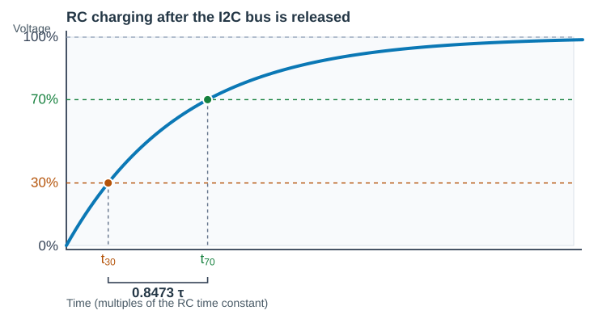

<a id="top"></a>

# RCET 3375 Lab 10 - I²C Communication

[RCET3375 course home](https://github.com/rosstimo/RCET3375) · [Lab assignments](https://github.com/rosstimo/RCET3375/tree/main/LabAssignments)

PIC16F883 | pic-as | MSSP / I²C | UART | Multi-device communication

> **Release status:** Parts 1–3 are available. Parts 4–5 remain in development and are not released.

## Contents

- [Purpose](#purpose)
- [Standards and references](#references)
- [Equipment and materials](#equipment)
- [Part 1 - I²C Master and Bus Timing](#part-1)
- [Part 2 - I²C Master with an ADS1115 Sensor Slave](#part-2)
- [Part 3 - PIC I²C Slave: Inputs, Display, and ADC](#part-3)
- [Part 4 - UART-to-I²C System Integration](#part-4)
- [Part 5 - Mastery: Three-Axis Servo Control](#part-5)
- [Submission and checkoff](#submission)

<a id="purpose"></a>
## Purpose

Use the PIC16F883 MSSP peripheral for I²C communication. Begin with an address-only master transaction and measurements of the two-wire bus. Later parts add an external sensor, a second PIC operating as a slave, and UART integration.

**Repository setup:** Create one Git repository for Lab 10. Add the [student lab `.gitignore` template](https://github.com/rosstimo/RCET3375/blob/main/HowTo/Student-Lab-Repository.gitignore) before staging project files. Keep complete MPLAB X projects and follow the [Lab Standard's repository rules](https://github.com/rosstimo/RCET3375/blob/main/LAB_STANDARD.md#assignment-repository-standard).

[Back to top](#top) · [Lab assignments](https://github.com/rosstimo/RCET3375/tree/main/LabAssignments)

<a id="references"></a>
## Standards and references

- [RCET 3375 Lab Standard](https://github.com/rosstimo/RCET3375/blob/main/LAB_STANDARD.md): lab book, SFR maps, schematics, electrical checks, measurements, and submission.
- [RCET PIC-AS Style Guide](https://github.com/rosstimo/RCET3375/blob/main/Notes/RCET_PIC-AS_Style_Guide.md) and [PIC-AS project setup](https://github.com/rosstimo/RCET3375/blob/main/HowTo/PIC-AS-Project-Setup.md).
- [PIC16F882/883/884/886/887 data sheet (DS40001291H)](https://ww1.microchip.com/downloads/en/DeviceDoc/40001291H.pdf): PIC16F883 pinout, MSSP/I²C master registers (Section 13), timers, and electrical limits.
- [PIC16F88X silicon errata](https://ww1.microchip.com/downloads/aemDocuments/documents/MCU08/ProductDocuments/Errata/PIC16F88X-Family-Si-Errata-Data-Sheet-Clarifications-DS80000302.pdf): device-revision limitations and MSSP clarifications.
- [PICmicro Mid-Range MCU Family Reference Manual (DS33023A)](https://ww1.microchip.com/downloads/en/DeviceDoc/33023a.pdf), especially [Section 17: MSSP](https://ww1.microchip.com/downloads/en/DeviceDoc/31017a.pdf): I²C timing, START/STOP sequences, electrical connections, and master/slave operation.
- [AN735: Using the PICmicro MSSP Module for Master I²C Communications](https://ww1.microchip.com/downloads/en/AppNotes/00735a.pdf) ([application note and source-code downloads](https://www.microchip.com/en-us/application-notes/an735)): master setup and transmission examples.
- [AN734: Using the PICmicro for Slave I²C Communication (original)](https://ww1.microchip.com/downloads/en/appnotes/00734a.pdf): interrupt-driven slave assembly example in Appendix A for later parts.
- [AN734: Slave I²C Communication (revised)](https://ww1.microchip.com/downloads/aemDocuments/documents/MCU08/ApplicationNotes/ApplicationNotes/00000734C.pdf) ([application note and source-code downloads](https://www.microchip.com/en-us/application-notes/an734)): flowcharts and code examples for newer PIC hardware; adapt register details to the PIC16F883.
- [TB3252: Using the MSSP in I²C Master Mode](https://www.microchip.com/en-us/application-notes/tb3252): master operation and pull-up considerations on newer devices.
- [AN736: An I²C Network Protocol for Environmental Monitoring](https://www.microchip.com/en-us/application-notes/an736): application-level communication example for later parts.
- [I²C-bus specification (NXP UM10204)](https://www.nxp.com/docs/en/user-guide/UM10204.pdf): Standard-mode electrical timing, pull-up calculations, and waveform definitions.
- [Lab 08 - UART](https://github.com/rosstimo/RCET3375/blob/main/LabAssignments/Lab08-UART.md): UART packets, host GUI, ADC, and servo integration in later parts.
- [Texas Instruments ADS1115 data sheet (SBAS444E)](https://www.ti.com/lit/ds/symlink/ads1115.pdf): device addressing, Config and Conversion registers, read/write transactions, and conversion timing.
- Breakout-board schematic or manufacturer documentation for its power, pull-up resistors, and signal-level connections.

Use the PIC16F883 data sheet for device-specific register settings and limits. The application notes and family manual provide implementation examples.

[Back to top](#top) · [Lab assignments](https://github.com/rosstimo/RCET3375/tree/main/LabAssignments)

<a id="equipment"></a>
## Equipment and materials

**Part 1:** One PIC16F883 minimum circuit with a 4 MHz crystal, 5 V supply, PICkit 3 (or equivalent), MPLAB X/pic-as, single I²C pull-up resistors in common values near the four calculated test targets (two of each chosen value, one per bus line), breadboard components, multimeter, and an oscilloscope with I²C decoding. Provide scope access to RC3/SCL, RC4/SDA, RA0, and RA1.

**Later parts:** A second PIC16F883 circuit, supplied I²C sensor breakout and input source, Lab 08 UART host application and serial adapter, ADC sensor and servo components, and optional Mastery hardware.

[Back to top](#top) · [Lab assignments](https://github.com/rosstimo/RCET3375/tree/main/LabAssignments)

<a id="part-1"></a>
## Part 1 - I²C Master and Bus Timing

### Goal

Use one PIC16F883 as a 100 kHz I²C master. Send a periodic address-only write transaction with no slave connected. Detect the expected NACK, generate STOP, and measure the bus waveforms.

### Required behavior

- Use a **4 MHz crystal** and a **5 V** PIC16F883 circuit. Connect **RC3/SCL (pin 14)** and **RC4/SDA (pin 15)** to 5 V through **separate 4.7 kΩ pull-up resistors**. Leave the I²C bus without a slave for this part. Configure the pins for MSSP open-drain operation.
- Configure the MSSP for **7-bit I²C master mode at 100 kHz**. Address **`0x20`** with **R/W = 0**. The address and R/W bit form the transmitted byte **`0x40`** (`0100 0000` binary).
- For every probe, generate **START**, send the address/R-W byte, read the **ACK/NACK** result, and generate **STOP**. With no slave, the ninth clock pulse must show a NACK (SDA HIGH).
- Use a hardware timer to start repeated address transmissions. Choose a timer interval that leaves a clear idle gap between the STOP of one transaction and the START of the next. Calculate the expected interval from your chosen timer settings.
- Use **RA0 (pin 2)** as a NACK indicator. Clear RA0 at the beginning of each probe; make it HIGH if the slave does not acknowledge. Leave it LOW for ACK. Complete the transaction with STOP in either case.
- Use **RA1 (pin 3)** as a timer diagnostic. Set RA1 HIGH when the timer event starts a new transaction, just before calling **AddressProbe**. Set it LOW after **AddressProbe** returns, following STOP. Each RA1 rising edge marks the start of a new transaction and provides an oscilloscope trigger without I²C decoding.

### Before Lab

Prepare the following in the lab book before constructing the circuit:

- A schematic with the PIC power, reset, oscillator, programming connections, separate SDA/SCL pull-ups, and RA0/RA1 diagnostic connections. Account for every used pin and component as required by the [Lab Standard](https://github.com/rosstimo/RCET3375/blob/main/LAB_STANDARD.md).
- PIC16F883 SFR documentation for MSSP master setup, START/STOP control, address transmission, completion and ACK status, the selected timer's setup and event indication, and the I/O configuration used here. Include the relevant register maps and the values you plan to use.
- Flowcharts for the main loop and **AddressProbe** subroutine. Show the timer event, RA1 diagnostic signal, START, address transmission, NACK decision, STOP, and return.
- Predicted SCL clock period and frequency and the interval between transactions based on the selected timer.
- **Pull-up resistor investigation:** Starting with the nominal **4.7 kΩ** resistor, calculate the target resistance for **nominal**, **nominal × 10**, **nominal ÷ 2**, and **nominal ÷ 10**. For each target, select and document a nearby common resistor value that is actually available. Use **one resistor per bus line** for each test; do not combine resistors. Record the calculated target, chosen standard value, resistor rating, and predicted electrical results for each test.
- For **both SDA and SCL** at every selected resistance, predict the **idle HIGH voltage**, **current through the pull-up with the bus idle and with the line driven LOW**, and **30%-to-70% rise time**. State the assumed bus capacitance and LOW voltage. Compare predictions with the I²C Standard-mode electrical requirements and PIC16F883 pin limits before applying power.
- Compile the Part 1 source and program the PIC **before starting the In the Lab steps**.

**MSSP timing example:** For a 4 MHz oscillator and 100 kHz I²C clock, find the master baud-rate value using the data sheet equation.

```math
\begin{aligned}
f_{\mathrm{SCL}} &= \frac{F_{\mathrm{OSC}}}{4(\mathrm{SSPADD}+1)}\\
\mathrm{SSPADD} &= \frac{F_{\mathrm{OSC}}}{4f_{\mathrm{SCL}}}-1\\
&=\frac{4\ \mathrm{MHz}}{4(100\ \mathrm{kHz})}-1\\
&=10-1=9\\
T_{\mathrm{SCL}} &= \frac{1}{100\ \mathrm{kHz}}
=10\ \mu\mathrm{s}
\end{aligned}
```

**Pull-up voltage and current example:** With neither SDA nor SCL driven LOW, each line should be close to the 5 V supply and the ideal pull-up current is zero. For a LOW line, estimate the current through one nominal 4.7 kΩ resistor using an assumed 0.4 V LOW level.

```math
\begin{aligned}
V_{\mathrm{idle}} &\approx V_{\mathrm{DD}}=5.0\ \mathrm{V}\\
I_{\mathrm{idle}} &= \frac{V_{\mathrm{DD}}-V_{\mathrm{idle}}}{R_{\mathrm{P}}}\\
&=\frac{5.0\ \mathrm{V}-5.0\ \mathrm{V}}{4.7\ \mathrm{k}\Omega}\\
&=0\ \mathrm{mA}\\
I_{\mathrm{LOW}} &= \frac{V_{\mathrm{DD}}-V_{\mathrm{OL}}}{R_{\mathrm{P}}}\\
&=\frac{5.0\ \mathrm{V}-0.4\ \mathrm{V}}{4.7\ \mathrm{k}\Omega}\\
&=\frac{4.6\ \mathrm{V}}{4.7\ \mathrm{k}\Omega}\\
&\approx 0.979\ \mathrm{mA}
\end{aligned}
```

**I²C rise-time calculation:** Begin with the RC charging equation used in class. Let $V_i$ be the initial line voltage, $V_f$ the final voltage, and $\tau=R_{\mathrm{P}}C_{\mathrm{bus}}$ the time constant.

```math
\begin{aligned}
V(t) &= V_f-(V_f-V_i)e^{-t/\tau}\\
\tau &= R_{\mathrm{P}}C_{\mathrm{bus}}
\end{aligned}
```

For the pull-up estimate, assume the line starts at $V_i=0\ \mathrm{V}$ and rises toward $V_f=V_{\mathrm{DD}}$. Solve the charging equation for the time at which the line reaches a chosen fraction of $V_{\mathrm{DD}}$:

```math
\begin{aligned}
V(t) &= V_{\mathrm{DD}}(1-e^{-t/\tau})\\
\frac{V(t)}{V_{\mathrm{DD}}} &= 1-e^{-t/\tau}\\
e^{-t/\tau} &= 1-\frac{V(t)}{V_{\mathrm{DD}}}\\
t &= -\tau\ln\left(1-\frac{V(t)}{V_{\mathrm{DD}}}\right)
\end{aligned}
```

<p align="center">
  
</p>


I²C rise time is measured from **30% to 70%** of the bus voltage. Calculate the time to reach each threshold, then subtract:

```math
\begin{aligned}
t_{30\%} &= -\tau\ln(1-0.30)\\
&= -\tau\ln(0.70)\\
&\approx 0.356675\tau\\[6pt]
t_{70\%} &= -\tau\ln(1-0.70)\\
&= -\tau\ln(0.30)\\
&\approx 1.203973\tau\\[6pt]
t_{\mathrm{r}} &= t_{70\%}-t_{30\%}\\
&\approx (1.203973-0.356675)\tau\\
&\approx 0.8473\tau\\
&\approx 0.8473R_{\mathrm{P}}C_{\mathrm{bus}}
\end{aligned}
```

**Worked example:** Assume a nominal 4.7 kΩ pull-up and 100 pF bus capacitance. The capacitance is an example assumption, not a measured value.

```math
\begin{aligned}
\tau &= R_{\mathrm{P}}C_{\mathrm{bus}}\\
&=(4.7\ \mathrm{k}\Omega)(100\ \mathrm{pF})\\
&=470\ \mathrm{ns}\\[6pt]
t_{\mathrm{r}} &\approx 0.8473(470\ \mathrm{ns})\\
&\approx 398.231\ \mathrm{ns}
\end{aligned}
```

Standard-mode I²C specifies a **maximum 1 µs rise time**, and its LOW-level current specification is based on **3 mA**. The lowest-resistance test can require substantially more LOW-state current. Check whether each chosen resistor meets the PIC pin current/voltage limits and I²C electrical requirements; explain any out-of-specification prediction. Do not power a circuit that exceeds the PIC's electrical limits. The circuit has wiring, pin, and oscilloscope-probe capacitance even with no slave connected.

### Required setup

```text
MSSP:
    Set up I²C master operation at 100 kHz
    Enable the peripheral for SDA and SCL

Timer:
    Configure a hardware timer for a repeat interval that separates address transactions
    Clear its event indication and start it

I/O:
    Set RA0 as a digital output for the NACK indicator
    Set RA1 as a digital output for the timer diagnostic
    Configure the other used pins for their required functions

Startup:
    Initialize both diagnostic outputs LOW
```

### Program structure

```text
Main:
    Wait for the chosen timer's event
    Clear the timer event indication
    Set RA1 HIGH
    Call AddressProbe
    Set RA1 LOW
    Repeat

AddressProbe:
    Clear the NACK indicator
    Generate a START condition and wait until it completes
    Send the slave address with the write bit and wait until the byte is sent
    Check the acknowledge result
    If the result is NACK, turn on the NACK indicator
    Generate a STOP condition and wait until it completes
    Return
```

### In the Lab

1. Build the circuit. Check the supply setting, ground, SDA/SCL pull-ups, and connections before applying power, then measure 5 V at the PIC. Leave the bus without a slave.
2. Connect **CH1 = SDA**, **CH2 = SCL**, **CH3 = RA0 (NACK)**, and **CH4 = RA1 (timer diagnostic)**. Trigger on the **rising edge of CH4**.
3. Measure the interval between **RA1 rising edges** and compare it with your calculated timer interval.
4. With power off, remove one pull-up at a time and observe the effect. Restore both resistors and verify normal operation.
5. Configure **7-bit I²C decoding** and capture START, the seven address bits (`0x20`), R/W = 0, the ninth-clock NACK, and STOP. Verify RA0 indicates NACK. Note if your decoder displays the 8-bit address/R-W byte (`0x40`) instead and verify oscilloscope decode setup. Verify that RA1 rises before START and falls after STOP, with a clear idle gap between transactions.
6. With nominal pull-ups installed, measure the **SCL period/frequency**, clock HIGH/LOW times, **SDA/SCL rise times (30% to 70%)**, idle HIGH and driven LOW voltages, and supply voltage.
7. Repeat the measurements for **nominal, nominal × 10, nominal ÷ 2, and nominal ÷ 10** resistance targets. Use one selected standard resistor per line, with no combinations. **Power off before changing resistors** and measure each resistor's actual value. Check electrical limits before powering each configuration. Calculate idle and LOW pull-up currents from measured voltages and resistances. Compare predicted and measured values for both lines; note if idle current is below measurement resolution.

### Evidence

Include the schematic and component/loading checks, complete MSSP/chosen-timer/I/O SFR documentation, flowcharts, final pic-as source, and the calculation steps and predictions.

Include a **four-configuration comparison table** showing the calculated resistance target, the selected common single-resistor value, actual measured resistance on each line, predicted and measured idle HIGH voltage, predicted and measured **idle/LOW pull-up current** (current derived from measured voltage/resistance), and predicted and measured rise time **for both SDA and SCL**. Note any current below measurement resolution and any I²C specification limits not met.

Provide labeled scope captures showing:

- A complete address-only transaction captured by **triggering on RA1**, before using I²C decoding. Include SDA, SCL, RA0, and RA1.
- A decoded transaction showing START, address `0x20`, R/W = 0, ninth-bit NACK, and STOP.
- Expanded SCL/SDA timing with measured frequency and clock HIGH/LOW times, plus rise-time and idle/LOW voltage captures for each of the **four pull-up configurations**.
- Consecutive RA1 pulses with a measured **rising-edge-to-rising-edge interval**, compared with the chosen timer's predicted interval.
- The pull-up removal observations and the restored normal waveform.

For each measurement, record the predicted value, measured value, and an explanation of any significant difference. Distinguish the **calculated target resistance**, **chosen standard resistor**, and **measured installed resistance**. Include the I²C decoder setting so that `0x20` (7-bit address) and `0x40` (address/R-W byte) are not confused.

### Demonstrate

Trigger the oscilloscope from **RA1 before enabling I²C decoding**, then show the START/address/NACK/STOP sequence with the decoder and explain the nine clock pulses. Demonstrate RA0's NACK indication, compare the measured SCL clock and RA1 repeat interval with your calculations, and explain the effects of all four pull-up values on idle voltage, LOW-state current, rise time, and I²C specification compliance.

### Complete When

A PIC16F883 master repeatedly sends the specified address with no slave, detects NACK, and completes STOP. RA1 can trigger the oscilloscope and shows a clear idle interval between transactions. The four resistor tests have predicted/measured SDA and SCL voltages, pull-up currents, rise times, and documented specification comparisons. The waveforms, timing comparisons, pull-up removal observations, source code, and lab-book evidence are complete and ready for instructor checkoff.

[Back to top](#top) · [Lab assignments](https://github.com/rosstimo/RCET3375/tree/main/LabAssignments)

<a id="part-2"></a>
## Part 2 - I²C Master with an ADS1115 Sensor Slave

### Goal

Use the Part 1 I²C master to identify an ADS1115, inspect and change its configuration, and read its ADC results. Observe the conversion-ready signal to choose a suitable reading interval.

### Before Lab

- Bring your **working Part 1 address-probe program**, compiled and programmed into the PIC.
- Skim the [ADS1115 data sheet](https://www.ti.com/lit/ds/symlink/ads1115.pdf). Find the pin descriptions, supply/input limits, and I²C address selection. You will investigate the registers and configure the ADC as you work through the lab.

Follow the [Lab Standard](https://github.com/rosstimo/RCET3375/blob/main/LAB_STANDARD.md) for the lab book, schematic, SFR documentation, flowcharts, and source code. Add each new piece of documentation as you reach it in the procedure.

### Suggested implementation (optional)

The [three-level I²C software design guide](support/Lab10-I2C-Three-Level-Student-Guide.md) offers **one possible implementation** with flowcharts, pseudocode, and I²C transaction sequences. It is a reference, **not required program structure**. You may adapt it or develop your own implementation that meets the lab requirements; no particular routine layout or number of source files is required.

### In the Lab

**1. Find the ADS1115 address.** Connect the breakout to the Part 1 SDA/SCL bus. Before applying power, check the board's supply and I²C logic levels against the PIC circuit. Document the connections in your schematic.

> **Pull-up hint:** With power **off** and the breakout disconnected from the PIC and external pull-ups, measure resistance with a DMM from SDA and SCL to the board's supply rail. Check ADDR and ALERT/RDY the same way. These measurements can reveal installed pull-ups; inspect the board markings or schematic to confirm because other onboard components may affect an in-circuit resistance reading.

Find the **four possible 7-bit ADS1115 addresses** in the data sheet. With **ADDR tied to GND**, use the Part 1 probe to try **all four addresses**, recording ACK or NACK for each. **Power off before moving ADDR to VDD**, then probe **all four addresses again**. Modify the probe so each trial runs **once after MCLR reset**, then enters a **do-nothing loop** instead of repeating. For each scope capture, arm the oscilloscope in **Single Sequence** mode, then press and release MCLR.

```text
For each candidate: START → [address + Write bit] → ACK or NACK → STOP
```

Record all **eight results** in a table:

| 7-bit address from data sheet | Transmitted write byte | ADDR = GND | ADDR = VDD |
| --- | --- | --- | --- |
| | | ACK / NACK | ACK / NACK |
| | | ACK / NACK | ACK / NACK |
| | | ACK / NACK | ACK / NACK |
| | | ACK / NACK | ACK / NACK |

Save a decoded ACK capture for each ADDR condition. For the remaining steps, **choose either ADDR connection that produced an ACK** and use its confirmed address. In the sequences below, `ADDR+W` and `ADDR+R` mean the transmitted address byte formed from your chosen **7-bit address** with the write bit (`0`) or read bit (`1`).

**2. Read the Config register.** Find the ADS1115 register-pointer table. The one-byte pointer `0x01` selects Config; it does **not** overwrite Config. On a freshly powered ADS1115, the expected Config value is **`0x8583`**. Select the pointer, then read the 16-bit register with a new START.

```text
Select Config (once):
START → ADDR+W → ACK → 0x01 → ACK → STOP

Read Config (once):
START → ADDR+R → ACK → Config MSB → PIC ACK → Config LSB → PIC NACK → STOP
```

Run the pointer write and Config read **once after MCLR reset**, then enter a **do-nothing loop**. Arm the oscilloscope in **Single Sequence** mode before releasing MCLR. Combine the two bytes and explain the observed Config fields using the data sheet. **MCLR resets the PIC, not the ADS1115**; to check the ADS1115's power-up value, power-cycle the ADC before this test. The ACKs after address/pointer bytes come from the ADS1115; **PIC ACK** and **PIC NACK** are sent by the master after received bytes.

**3. Configure the ADC.** Now use the Config register descriptions to determine the two bytes required for:

- AIN0 relative to GND
- ±6.144 V full-scale range
- Continuous conversion mode
- 128 samples per second
- Comparator disabled

Document each chosen field and derive the complete 16-bit value yourself. Write it using this transaction:

```text
Configure ADC (once at startup):
START → ADDR+W → ACK → 0x01 → ACK → [Config MSB] → ACK → [Config LSB] → ACK → STOP
```

Run the Config write **once after MCLR reset**, then enter a **do-nothing loop** for its Single Sequence capture. Read Config again to verify the settings, also **once**, using the read transaction from Step 2; the write already selected Config. **Do not repeat the Config write on every ADC read.**

**4. Read ADC conversions.** Connect a potentiometer across ADS1115 VDD and GND, with its wiper at AIN0. Do not exceed the ADC's supply voltage at its analog input.

The ADS1115 now converts **continuously on its own**. The PIC reads the latest completed result only when it requests it. If the ADS1115 has lost power since Step 3, configure it **once** before starting the read loop. Start with the timer interval from Part 1; you will choose a final interval in Step 5.

Each PIC polling cycle repeats **both** transactions:

```text
Select Conversion:
START → ADDR+W → ACK → 0x00 → ACK → STOP

Read Conversion:
START → ADDR+R → ACK → ADC MSB → PIC ACK → ADC LSB → PIC NACK → STOP

Repeat both transactions at the PIC timer interval.
```

The ADS1115 retains its register pointer, but for this lab **send pointer `0x00` on every polling cycle**. If an address or write-data byte is NACKed, stop sending data, attempt STOP, and preserve/report the error. On a timeout or bus-low error, report the failure and do not assume STOP or bus recovery will succeed; do not continue the transaction. The master's NACK after the final *received* byte is normal.

Combine the ADC bytes as a signed 16-bit result. For the assigned full-scale range:

```math
\begin{aligned}
\mathrm{ADC}_{16} &= (\mathrm{MSB}\ll8)\;|\;\mathrm{LSB}\\
V_{\mathrm{AIN0}} &= \frac{\mathrm{signed\ ADC}_{16}}{32768}(6.144\ \mathrm{V})
\end{aligned}
```

For example, a positive result of `0x2000` = 8192 counts gives:

```math
V_{\mathrm{AIN0}}=\frac{8192}{32768}(6.144\ \mathrm{V})=1.536\ \mathrm{V}
```

The ±6.144 V range determines ADC scaling; it does **not** raise the allowable input voltage above ADS1115 VDD.

**5. Observe ALERT/RDY and choose a polling interval.** Find **Conversion Ready Pin** in the ADS1115 data sheet. Configure ALERT/RDY for conversion-ready pulses using the threshold registers and Config fields. The output is open-drain; ensure it has a pull-up to a compatible supply.

```text
Set low threshold (once):
START → ADDR+W → ACK → 0x02 → ACK → [Lo MSB] → ACK → [Lo LSB] → ACK → STOP

Set high threshold (once):
START → ADDR+W → ACK → 0x03 → ACK → [Hi MSB] → ACK → [Hi LSB] → ACK → STOP

Enable conversion-ready output (once):
START → ADDR+W → ACK → 0x01 → ACK → [Updated Config MSB] → ACK → [Updated Config LSB] → ACK → STOP
```

Perform the ALERT/RDY setup writes only once, then leave the PIC in a **do-nothing loop** while the ADS1115 converts on its own. Trigger the oscilloscope on ALERT/RDY. Measure the interval between pulses and calculate the observed conversion rate. Compare it with the configured data rate. **Choose and justify a PIC timer interval** for repeated I²C reads. Explain whether that interval will retrieve every conversion or skip some. Confirm the actual interval between I²C read cycles on the scope.

**6. Capture continuous reading.** With your selected PIC timer interval, capture **multiple consecutive** Conversion-pointer/write and Conversion-read transactions at **each potentiometer extreme**. Measure AIN0 with a DMM at each setting and compare the measured voltage with the ADC result. Use **CH1 = SDA** and **CH2 = SCL** for decoding; connect another scope channel to ALERT/RDY for the timing test.

### Evidence

Include labeled scope captures or decode records for these **five I²C checks**:

| Capture | Expected activity |
| --- | --- |
| Address probe with ACK | Table of all four data-sheet addresses tested with ADDR at GND and VDD (**eight ACK/NACK results**), plus one decoded ACK capture for each condition |
| Config pointer | Write `0x01`, ACK, STOP |
| Config read | Two bytes (expected power-up value `0x8583`), PIC ACK after MSB and PIC NACK after LSB |
| Config write | Pointer and both student-calculated Config bytes, with ACKs |
| Repeating ADC reads | **Two captures**, one at each potentiometer extreme, showing multiple consecutive pointer-write/read cycles |

For the one-shot address, pointer, Config read, and Config write captures, use **Single Sequence** acquisition after **MCLR reset** and show that firmware then idles. Also include the ALERT/RDY waveform and measured conversion period; PIC polling interval calculation and measurement; signed ADC values and DMM voltage comparisons; updated schematic; relevant register documentation, flowcharts, and final PIC-AS source. Label addresses, data, START/STOP, and which device produces each ACK/NACK.

### Demonstrate

Show both ADDR settings, the initial Config read, Config write and readback, repeated ADC readings at both potentiometer extremes, and the ALERT/RDY waveform. Explain which transactions run only during setup and which repeat in the PIC polling loop.

### Complete When

The ADS1115 is correctly addressed and configured; the PIC repeatedly reads valid 16-bit ADC results at a justified interval; and all required captures, calculations, documentation, and checkoff are complete.

[Back to top](#top) · [Lab assignments](https://github.com/rosstimo/RCET3375/tree/main/LabAssignments)

<a id="part-3"></a>
## Part 3 - PIC I²C Slave: Inputs, Display, and ADC

### Goal

Part 3 requires **two PIC16F883 programs: I²C master code and I²C slave code**, running on separate PICs. Develop the slave at **7-bit address `0x20`** and extend your Part 2 master code to test the slave, read its digital inputs, write display characters, and retrieve 10-bit ADC measurements. The slave uses a small **register-pointer interface** similar in concept to the ADS1115.

The slave must normally service I²C events promptly. **Either interrupts or polling the MSSP event flag is acceptable.** Keep hardware communication routines reusable and separate from application behavior.

### Before Lab

- Bring your working **Part 1/Part 2 master source code**. For Part 3, create a **master MPLAB X project** and a **separate slave MPLAB X project**. You will write, build, program, and test **both master and slave firmware** throughout Part 3. Select the correct *Main Project* before programming each PIC.
- Draw the complete two-PIC system schematic: **RC3/SCL (pin 14)**, **RC4/SDA (pin 15)**, common ground, and the effective SDA/SCL pull-ups. Account for pull-ups already installed on connected boards; do not assume every device needs another pair.
- Use the [PIC16F883 data sheet](https://ww1.microchip.com/downloads/en/DeviceDoc/40001291H.pdf) to document MSSP **7-bit slave-mode** setup, address matching, SSPBUF, ACK/NACK, receive/transmit events, SSPIF, CKP/clock stretching, SSPOV and WCOL. Explain which device controls the final ACK/NACK of a read and when the slave can hold SCL LOW.
- Prepare flowcharts for slave initialization and servicing an I²C event. Include receive-address, receive-data, transmit-data, and error paths. Extend these flowcharts as new behavior is introduced.

Follow the [Lab Standard](https://github.com/rosstimo/RCET3375/blob/main/LAB_STANDARD.md) for SFR documentation, schematic updates, source, flowcharts, measurements, and lab-book evidence. Complete the additional documentation when you reach each device or peripheral.

### Suggested software organization (optional)

One approach is to separate the **slave code** into **Level 1 (MSSP hardware events)**, **Level 2 (pointer and read/write transactions)**, and **Level 3 (PORTB, display, ADC)**. The [three-level I²C slave design guide](support/Lab10-I2C-Slave-Three-Level-Student-Guide.md) provides optional flowcharts, pseudocode, and transaction examples. The **master code** can reuse your Part 2 I²C routines, with new application logic to send each test transaction and receive its results. This is a suggested design, not a required file layout. Each PIC project may use one PIC-AS `.S` file or multiple `.S` modules if responsibilities are clear. Do not put executable routines in `.inc` files.

### In the Lab

**For every step, develop and test both sides of the I²C link:** the **master** must initiate the required transactions and process any returned data or status; the **slave** must recognize its address and handle the corresponding requests. Do not submit only the slave firmware or rely on an unchanged Part 2 master for the completed Part 3 assignment.

**1. Verify the slave address.** Assemble the minimum slave circuit and connect it to the existing master SDA/SCL bus. Confirm the slave PIC is programmed and powered. Configure its MSSP for the **7-bit address `0x20`**.

Use the Part 1 master address probe, first with the assigned address and then with an unrelated address. Capture an ACK for the correct address and a NACK for the other address. The 7-bit address and complete transmitted bytes are different:

```text
START → 0x20 + W (0x40) → slave ACK → STOP
START → other address + W → NACK → STOP
```

**2. Test one received byte and one transmitted byte.** Extend the slave to accept a byte after its address and **modify the master to perform both tests**. First write `0xA5` and check both slave ACKs. Next have the slave return a fixed byte `0x5A` to a master read. For the one-byte read, the **master** sends NACK after receiving the byte.

```text
Write test: START → 0x40 → ACK → 0xA5 → ACK → STOP
Read test:  START → 0x41 → ACK → 0x5A → Master NACK → STOP
```

Keep these tests small. Verify them on the oscilloscope before adding the register-pointer logic.

**3. Add the register-pointer interface.** A slave write begins with a pointer byte. The pointer selects a logical register; optional following bytes write that register. A later master read returns data from the selected register. Retain the selected pointer after STOP sequences.

For an initial diagnostic, temporarily echo the selected pointer on a read. Test at least two different values such as `0xA5` and `0x3C`. Then implement the following application register map:

| Pointer | Function | Direction | Data |
| --- | --- | --- | --- |
| `0x00` | PORTB switches | Read | One byte, RB5:RB0 |
| `0x01` | DLG7137 display | Write | One 7-bit ASCII character |
| `0x02` | PIC ADC at AN2 | Read | Two bytes, high then low |
| `0x04` | Device status, including I²C status | Read | One byte |

Document how your code handles an unsupported pointer or an unexpected number of data bytes.

**4. Read switches and status.** Connect six DIP switches from **slave RB0-RB5** to GND. Enable suitable pull-ups so an open switch reads `1` and a closed switch reads `0`. Reserve **RB6/RB7** for PICkit programming. Return only bits 5:0 for pointer `0x00`.

Add pointer `0x04` as a one-byte device-status register. **Include I²C-related status or fault information**, such as MSSP receive overflow or write collision. Choose your own status encoding and handling; document what each value means and how it is cleared. You may also report other useful conditions, such as ADC conversion busy/ready state, invalid data, or application faults. Read the status register after normal transactions and explain the result.

```text
Select PORTB: START → 0x40 → ACK → 0x00 → ACK → STOP
Read PORTB:   START → 0x41 → ACK → switch byte → Master NACK → STOP

Select status: START → 0x40 → ACK → 0x04 → ACK → STOP
Read status:   START → 0x41 → ACK → status byte → Master NACK → STOP
```

Change several DIP-switch patterns. Compare the actual switch positions, returned six-bit value, and oscilloscope decode. Keep the status read working as you add later features.

**Clock-stretching experiment.** After the PORTB read works normally, add a short **inline delay in the slave's PORTB read path**, while its MSSP hardware is holding **SCL LOW** and before it releases SCL to send the data byte. Compare a normal read with several progressively longer delays, for example **0, 100 µs, 1 ms, and 10 ms**. Calculate or measure the actual delay; do not assume that a software delay produces clock stretching unless the scope shows SCL held LOW.

Capture SDA and SCL and measure the extended SCL LOW time for each delay. Does the master wait and receive the correct PORTB byte? If the master has a timeout, determine approximately when it reports a failure and compare that limit with the measured stretch. If it has no timeout, explain how a stalled read behaves and how you regain control. Record the master's result for each test. Restore normal PORTB operation before proceeding.

**5. Write a character to the DLG7137.** Use the **DLG7137 single-character display** from Lab 02. It accepts seven-bit ASCII; the slave must drive its data lines and pulse its active-low WR input. **RC3 and RC4 remain dedicated to I²C**, so do not reuse the original PORTC wiring unchanged. Modify the DLG7137 wiring to use two available PORTA pins. Document and explain the change.

Check the [DLG7137 data sheet](https://www.mouser.com/catalog/specsheets/00034177_0.pdf) for orientation, control pins, power, and write timing. Document the wiring and decoupling. A write to pointer `0x01` followed by ASCII `0x41` should display **A**:

```text
START → 0x40 → ACK → 0x01 → ACK → 0x41 → ACK → STOP
```

Stage the received character and update the display outside the time-sensitive I²C event handler. Repeat with a different printable ASCII character. Confirm the PORTB and status reads still work.

**6. Read the slave's ADC.** Connect a potentiometer between the slave's **VDD and GND**, with the wiper on **RA2/AN2 (pin 4)**. Configure the PIC's **10-bit ADC**, VDD/VSS references, and right-justified result. Use a timer to sample periodically without waiting in a long blocking loop.

Pointer `0x02` returns a **consistent two-byte sample**: upper two ADC bits in the first byte, lower eight bits in the second. Store conversions in RAM and ensure that I²C read bytes cannot come from different ADC conversions.

```text
Select ADC: START → 0x40 → ACK → 0x02 → ACK → STOP
Read ADC:   START → 0x41 → ACK → ADC high → Master ACK → ADC low → Master NACK → STOP
```

Combine the received bytes and estimate the input voltage using the measured supply voltage:

```math
\begin{aligned}
\mathrm{ADC}_{10} &= ((\mathrm{high}\mathbin{\&}0x03)\ll 8)\;|\;\mathrm{low} \\
V_{\mathrm{AN2}} &\approx \frac{\mathrm{ADC}_{10}}{1023}V_{\mathrm{DD}}
\end{aligned}
```

Measure the actual AN2 voltage at **GND, approximately midpoint, and VDD** settings. Compare each measurement with the I²C result (approximately 0, 512, and 1023 counts, respectively). Allow time for a valid conversion after reset. Verify that the scope shows the master's ACK between data bytes and NACK after the last byte.

### Evidence

Include the updated two-PIC and display schematics, relevant MSSP/GPIO/ADC SFR documentation, **complete PIC-AS source and MPLAB X projects for both the master and slave**, and flowcharts showing the master transaction sequences and slave behavior. Provide labeled I²C captures or decode records for:

- Correct-address ACK and incorrect-address NACK; the initial single-byte write and fixed-byte read.
- Pointer write followed by a separate read, with two different pointer values.
- PORTB read for multiple switch patterns and a status read, plus clock-stretching captures for each tested delay. Record measured SCL LOW times, returned data, and master success, timeout, or other observed behavior.
- Display write containing pointer `0x01` and ASCII character, plus evidence of the visible character.
- Two-byte ADC read, showing Master ACK after the high byte and Master NACK after the low byte, with measured-voltage comparisons at all three potentiometer settings.

Label the SDA/SCL channels, 7-bit slave address, transmitted address byte, START/STOP, data and ACK/NACK source. If you use a timer or any other diagnostic signals, document its pin and measured interval.

### Demonstrate

Show the master addressing the second PIC, changing the reported DIP-switch value, reading status, investigating clock stretching at two different delays, displaying two characters, and reading ADC data at the potentiometer extremes. Explain why the slave register pointer remains selected between transactions and why the master ACKs the first ADC byte but NACKs the last.

### Complete When

**Both master and slave firmware work together:** the master initiates each required transaction and handles the results; the slave responds at its assigned address, supports the stated pointer map, reads RB5:RB0, updates the DLG7137, and returns valid two-byte ADC results. The clock-stretching experiment is documented, and all captures, voltage comparisons, source, flowcharts, and checkoff evidence are complete.

**Part 3 ends with I²C communication between the two PICs.** Simultaneous ADS1115/PIC operation and deliberate communication-fault/recovery tests are reserved for Part 4.

[Back to top](#top) · [Lab assignments](https://github.com/rosstimo/RCET3375/tree/main/LabAssignments)

<a id="part-4"></a>
## Part 4 - UART-to-I²C System Integration

> **Review draft, not yet released:** Part 4 is ready for instructor review. Do not begin until the release notice at the top of this assignment is updated.

### Goal

Make the master PIC a general-purpose **PC/UART-to-I²C bridge**. Use the host application to identify and communicate with both the **ADS1115** from Part 2 and the **PIC16F883 slave at address `0x20`** from Part 3. Extend the slave with **one servo**, display both ADC measurements and the servo control in the GUI, and record measurements and communication errors.

Part 4 requires **three working programs**: master PIC firmware, slave PIC firmware, and a PC host application. Reuse your tested Part 2/3 I²C routines and the UART/servo concepts from [Lab 08 Part 4](Lab08-UART.md#part-4). Implement and check one feature at a time.

**Transaction scope:** One 100 kHz I²C master, ordinary **7-bit addresses `0x08` through `0x77`**, and one host request at a time. Use separate STOP-terminated writes and reads. **Repeated START, 10-bit addresses, general call, and multi-master operation are not required for Part 4.** The host must be able to test another standard 7-bit device without adding device-specific code to the master PIC, provided the device supports these transactions.

### Hardware and software boundaries

- **Master PIC:** Keep the 4 MHz crystal, PICkit, RC3/SCL, RC4/SDA, and existing I²C routines. Add the Lab 08 UART interface at **9600 baud, 8 data bits, no parity, 1 stop bit**, using a MAX232 or equivalent with correct RS-232/TTL level conversion. Keep a diagnostic signal to show when an I²C transaction is active.
- **I²C bus:** Connect both the ADS1115 module and Part 3 PIC slave, with common ground and appropriate SDA/SCL pull-ups. Identify **each device's actual 7-bit address**. Check the ADS1115 module's power and logic-voltage limits before connecting the 5 V PIC; account for pull-ups already on breakouts and use level shifting if necessary.
- **Slave PIC:** Retain the Part 3 register-pointer interface, switches, display, status, and AN2 ADC. Add one servo with a stable 20 ms frame. Provide suitable servo power and common ground; do not power a servo from a PIC output pin.
- **Pin and timer conflicts:** Part 3 uses **RC2 for a DLG7137 data bit**, whereas the PIC16F883 **CCP1 output is RC2**. If using CCP1 for servo timing, move that display connection to a suitable output and update its software mapping; do not drive the same pin with both functions. Part 3 also uses Timer1 for periodic ADC sampling, while the Lab 07/08 servo implementation uses Timer1 for its 20 ms timing. Reassign or derive the ADC sampling schedule so neither function interferes with the other. Document the resulting pin and timer ownership.
- **Program organization:** Maintain separate MPLAB X projects for the master and slave. Separate peripheral operations, complete I²C transactions, and application/GUI behavior clearly. One or multiple PIC-AS `.S` files are acceptable; executable routines do not belong in `.inc` files.

### Before Lab

Prepare or reference the [Lab Standard](../LAB_STANDARD.md) documents, then add:

1. A **complete system schematic** showing the PC serial interface, MAX232, master PIC, both I²C slaves, each power supply, pull-ups and logic levels, slave display, switches, AN2 sensor, and servo. Identify the changed slave display wiring and every reused or reassigned timer/pin.
2. Master and slave **flowcharts**: UART frame reception and reply, command validation, I²C request/result handling, slave register write/read, servo target validation and next-frame update, and timeout/error paths. Document relevant EUSART, MSSP, GPIO, ADC, Timer1/CCP1 (or your selected servo timing) registers.
3. A **host packet table**, including command, request length, payload bytes, successful response, and failure response. Use the protocol below or demonstrate an equivalent compatible packet contract.
4. A GUI sketch with **port identification**, both sensor readings, servo slider, device status, raw I²C test controls, transaction history, and connection/error indications. Plan how only one outstanding serial request will be handled at a time.
5. A data/error logging plan with filenames, field names, units, timestamps, file-rotation rules, and a test for forced communication loss and reconnection. State how you will verify hourly and 24-hour file rotation without waiting an entire day.

### UART bridge packet contract

Keep the Lab 08 framing. Every complete frame is:

```text
0x24  COMMAND  PAYLOAD_LENGTH  [PAYLOAD BYTES...]
```

The UART payload is limited to **24 bytes**. Use the following commands in the master and GUI. Hexadecimal examples below are **raw bytes**, not ASCII text representing hex values.

| Command | Request payload | Successful response | Requirement |
| --- | --- | --- | --- |
| `I` (`0x49`) | Empty | `24 49 02 33 75` | Recognize the bridge before issuing device commands |
| `P` (`0x50`) | `AA` | `24 50 01 00` | Probe address `AA`; return the I²C status |
| `W` (`0x57`) | `AA DATA...` | `24 57 01 00` | Write **1–23 data bytes** after the address |
| `R` (`0x52`) | `AA NN` | `24 52 (NN+1) 00 DATA...` | Read **1–23 bytes**, return status followed by data |
| `E` (`0x45`) | Response only | `24 45 01 EE` | Report an invalid application request |

`AA` is the **7-bit slave address**, not the transmitted address/R-W byte. `NN` is the requested read count. The status byte for `P`, `W`, and `R` is:

| I²C status | Meaning |
| --- | --- |
| `00` | Transaction successful |
| `01` | Address or data NACK |
| `02` | Timeout |
| `03` | Bus not idle / bus LOW |
| `04` | SCL held LOW |

For `R`, an unsuccessful transaction returns **`24 52 01 SS`** with **no data bytes**. Application error `EE` uses `01` for wrong length or count, `02` for unknown command, and `03` for an address outside `0x08..0x77`. Reject invalid requests before starting I²C activity. A NACK is an I²C result, not an application-format error.

**The master must not interpret register addresses or sensor values.** `W` sends the supplied data exactly as given. `R` reads from the device's currently selected register/state; it does not send a register pointer. The host may issue a separate pointer `W` followed by `R` when the slave preserves its pointer across STOP.

Examples using the PIC slave at `0x20`:

| Task | Host TX | Expected response |
| --- | --- | --- |
| Identify bridge | `24 49 00` | `24 49 02 33 75` |
| Probe PIC slave | `24 50 01 20` | `24 50 01 00` |
| Display ASCII A (pointer `0x01`) | `24 57 03 20 01 41` | `24 57 01 00` |
| Select slave ADC pointer `0x02` | `24 57 02 20 02` | `24 57 01 00` |
| Read the slave ADC's two bytes | `24 52 02 20 02` | `24 52 03 00 HH LL` |
| Reject a zero-byte read | `24 52 02 20 00` | `24 45 01 01` |

The `HH LL` bytes are measurements, not fixed values. Choose the ADS1115 address from your **actual Part 2 probe results** rather than assuming an address printed on a breakout.

### Slave servo extension

Keep the existing Part 3 register pointers. Add **`0x05` for a two-byte servo target**, high byte then low byte. For the Lab 07/08 Timer1/CCP1 implementation, the value is the **absolute CCP1 compare value** used in [Lab 08 Part 4](Lab08-UART.md#part-4).

| Slave pointer | Function | Direction | Data |
| --- | --- | --- | --- |
| `0x00` | PORTB switches | Read | One byte, RB5:RB0 |
| `0x01` | DLG7137 | Write | One printable 7-bit ASCII byte |
| `0x02` | AN2 ADC | Read | Consistent high byte, then low byte |
| `0x04` | Slave/application status | Read | Existing I²C faults plus any new servo/application fault indication |
| `0x05` | Servo target | Write | Two bytes, compare high then low |

Using a 4 MHz oscillator, Timer1 with 1 µs ticks and a 20 ms frame starting at `0xB1E0`, the required servo range is:

| Servo position | HIGH pulse | Absolute CCP1 match |
| --- | ---: | --- |
| 0° | 500 µs | `0xB3D4` |
| 90° | 1500 µs | `0xB7BC` |
| 180° | 2500 µs | `0xBBA4` |

The GUI maps a **0°–180° slider in 1° increments** to the corresponding 500–2500 µs pulse width and absolute compare value. For example, a centered 1500 µs command to slave `0x20` is a raw I²C write of pointer `0x05` plus the two compare bytes:

```text
Host request:  24 57 04 20 05 B7 BC
Bridge reply:  24 57 01 00
```

The I²C success reply reports that the bytes were acknowledged; **it does not prove the servo accepted the target**. The slave must validate the full two-byte value, reject values outside the allowed range without changing the last accepted target, and make application acceptance/failure observable through the status register. Do not apply a half-received target.

Start at **1500 µs**. Store a valid new target for the **next** 20 ms frame; never change the pulse in progress. Keep I²C service responsive while the servo runs. Avoid blocking delays, prolonged interrupt masking, and work in an I²C event path that could disrupt servo timing.

### In the Lab

**1. Bring up the UART bridge.** Add UART to the Part 3 master and confirm the `I` identity response from the host. Test `P` at the PIC slave's address and at an unoccupied address. Capture START, address, ACK or NACK, and STOP on SDA/SCL. Document the master’s UART TX/RX connections and diagnostics.

**2. Implement generic writes, reads, and errors.** Make `W` and `R` operate through your reusable I²C transaction routines, using bounded buffers. From the host, write two different characters to the slave display; read PORTB while changing a DIP switch; select and read the two-byte AN2 ADC at GND, midpoint, and VDD settings. Compare returned values with actual switches and measured voltage. Test an unoccupied-address NACK, a zero-byte read, an address-only write, and a 24-byte read request that must be rejected. Test the **accepted maximum of 23 read data bytes and 23 written data bytes**. Verify the last write data byte actually reaches the slave. Show an invalid request causes no I²C bus traffic. Preserve all previously working `I` and `P` responses.

**3. Bring both I²C slaves online.** Attach the ADS1115 and PIC slave to the bus together. Probe each at its confirmed address. From the host, read the ADS1115 Config register, apply your Part 2 continuous-conversion setup, and read its Conversion register using separate pointer `W` and `R` commands. Move the ADS1115 potentiometer through its range and check measured volts against its configured full-scale range. Then read the PIC slave AN2 ADC and PORTB without reprogramming the master. Keep both devices responding; a missing device must not prevent access to the other. Compare sensor-reading intervals with your Part 2 ALERT/RDY observations.

**4. Add and verify the slave servo.** Resolve the RC2/display pin conflict and ADC/servo timer conflict. Keep all Part 3 registers working. Verify the 500, 1500, and 2500 µs pulse widths and approximately 20 ms frame on the oscilloscope **before connecting the servo motor**. Send valid servo targets over host UART → master I²C → slave pointer `0x05`; read the slave status to confirm acceptance. Send one compare value below the minimum and one above the maximum and show the previous valid pulse remains unchanged. Confirm a new valid command takes effect at a later frame boundary.

**5. Extend the host GUI.** Reuse your Lab 08 serial host application or build an equivalent. The GUI must:

- Automatically search available serial ports at **9600 8N1**, accept only the exact `I` reply, and show the verified port and connection state. Do not send I²C commands to an unidentified port.
- Offer raw **probe, write, and read controls** for any supported 7-bit address, with data entered/displayed as hexadecimal bytes. Display exact TX/RX frames, decoded result, and timestamp in a scrollable history.
- Poll and display **both ADC channels at approximately 1-second intervals** (ADS1115 AIN0 and slave AN2), using the correct conversion/scaling for each device and measured references. Display useful status from the PIC slave.
- Show a 0°–180° servo slider, initially **90°**. Send the centered command **once after first identification at program startup**. Thereafter send a servo command only when the slider changes; do not automatically resend on reconnect.
- Reassemble frames when UART reads arrive in fragments. Keep **one request awaiting a response at a time**, enforce a documented response timeout, and keep the GUI responsive while polling, logging, or reconnecting.

**6. Add data and error logging.** Use timestamps containing **year, month, day, hour, minute, and second**, with a stated local/UTC time basis. Create **one sensor-data file for each hour**, rotating at the hour boundary, with timestamps, both device addresses, raw ADC codes, calculated engineering units, and any validity/status flags. Maintain a **separate UART/I²C error log**, rotating to a new file every **24 hours**, with timestamp, device/port, request context, error code, and recovery result. Record each verified disconnect and reconnect **once per transition**, not repeatedly on every failed poll. Demonstrate both rotations using a controlled test clock or time-boundary simulation rather than changing the computer's system clock.

**7. Test failures and simultaneous operation.** While the GUI polls both sensors and the servo operates, temporarily make one I²C slave unavailable using a safe power-off/disconnect procedure. Verify the other device remains accessible and that the host records the NACK or timeout and recovery. Disconnect the host USB-RS-232 adapter, confirm **COM ERR** or equivalent disconnected state and unavailable measurements, and automatically rediscover/verify the bridge after reconnecting (attempt about once per second). Do not queue device commands while disconnected. Include a second unrelated serial port in the discovery test. Record each transition once and avoid duplicate logs. Restore normal operation and verify a fresh reading from each device.

**8. Verify operation under load.** Run repeated host sensor requests while changing the servo position. Observe the servo output and SDA/SCL with the oscilloscope. Confirm the servo stays within the specified pulse and 20 ms frame limits, that both devices continue responding, and that failures are surfaced rather than silently reported as valid sensor values.

### Evidence

Submit the following, with the [Lab Standard](../LAB_STANDARD.md) records and diagrams:

- Updated **master and slave PIC-AS projects** and **host GUI source/project**, with build instructions and documented UART/I²C packet format and error meanings.
- Complete system schematic, pull-up and voltage compatibility checks, changed display/servo pinout, timer ownership, relevant SFR maps, and master/slave/GUI flowcharts.
- Host **TX/RX records** for the bridge identity, two device probes, display writes, switch reads, PIC ADC at three input settings, ADS1115 Config and Conversion reads, and successful/failed maximum-length transactions.
- Labeled scope captures of both devices' I²C activity, 23-byte read/write boundaries, a rejected malformed command without bus activity, and servo pulse timing before/after a command and during ongoing host transactions.
- GUI screenshots of both live sensors, servo setting, device status, raw command controls, packet history, and connected/disconnected/recovered states.
- Samples of **hourly sensor files** and **24-hour error files**, including evidence of rotations and a single recorded event for each disconnection/reconnection. Show deliberate NACK/timeout behavior and recovery.
- Servo valid/invalid target tests with measured pulse widths and evidence that the last accepted target stays in effect after an invalid request.

### Demonstrate

Identify the bridge automatically, probe and communicate with **both the ADS1115 and PIC slave**, show switch and two ADC readings responding to actual inputs, and control one servo from the GUI without affecting I²C reliability. Demonstrate a raw transaction against the bus, NACK handling, a disconnected/reconnected serial adapter, logging/rotation, and stable servo timing while both devices are active.

### Complete When

The PC host can send generic UART-directed `P`, `W` and `R` transactions; the master can access **both slaves without device-specific master code**; the PIC slave preserves its Part 3 behavior while driving a servo with a stable 20 ms frame; the GUI presents both sensors, status, and servo controls; and the required logs, timing evidence, failure/recovery demonstrations, and complete source projects are ready for instructor checkoff. **The repeated-START `X` command is not required.**

[Back to top](#top) · [Lab assignments](https://github.com/rosstimo/RCET3375/tree/main/LabAssignments)

<a id="part-5"></a>
## Part 5 - Mastery: Three-Axis Servo Control

> **Update in progress:** This part is being revised. Requirements may change. Do not begin this part until the updated instructions are released.

### Goal

Extend the system with three independent servos and a three-axis I²C compass or IMU.

### Before Lab

Select and document the sensor, axis-to-servo mapping, limits, scheduler changes and verification plan.

### In the Lab

Acquire all three axes and command the corresponding servos while maintaining the required servo period, communication and error handling.

### Evidence

Provide the updated schematic, packet/axis mapping, firmware and GUI changes, motion and timing captures, and error tests.

### Demonstrate

Show independent response of all three servos to the three measurements without interrupting the other system functions.

### Complete When

All three channels operate correctly and the multi-device system remains functional. Mastery earns the extra credit described in the [Lab Standard](https://github.com/rosstimo/RCET3375/blob/main/LAB_STANDARD.md).

[Back to top](#top) · [Lab assignments](https://github.com/rosstimo/RCET3375/tree/main/LabAssignments)

<a id="submission"></a>
## Submission and Checkoff

Maintain one Git repository for the assignment. Submit working projects, schematic files, source, flowcharts, measured evidence and lab-book PDF according to the [Lab Standard](https://github.com/rosstimo/RCET3375/blob/main/LAB_STANDARD.md). Parts 1-4 are required; Part 5 is optional Mastery.

[Back to top](#top) · [Lab assignments](https://github.com/rosstimo/RCET3375/tree/main/LabAssignments)
