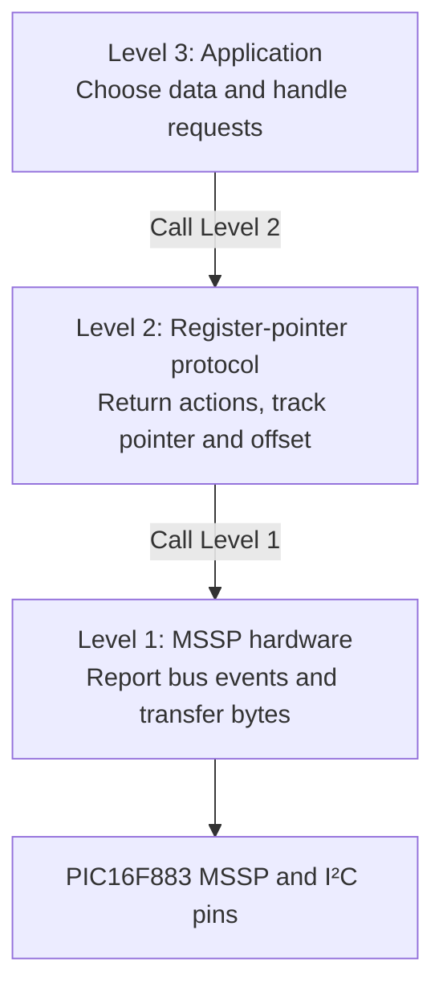
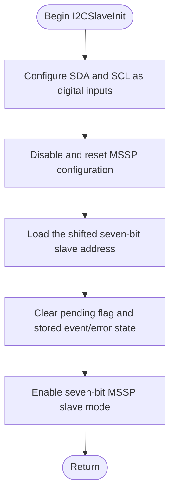
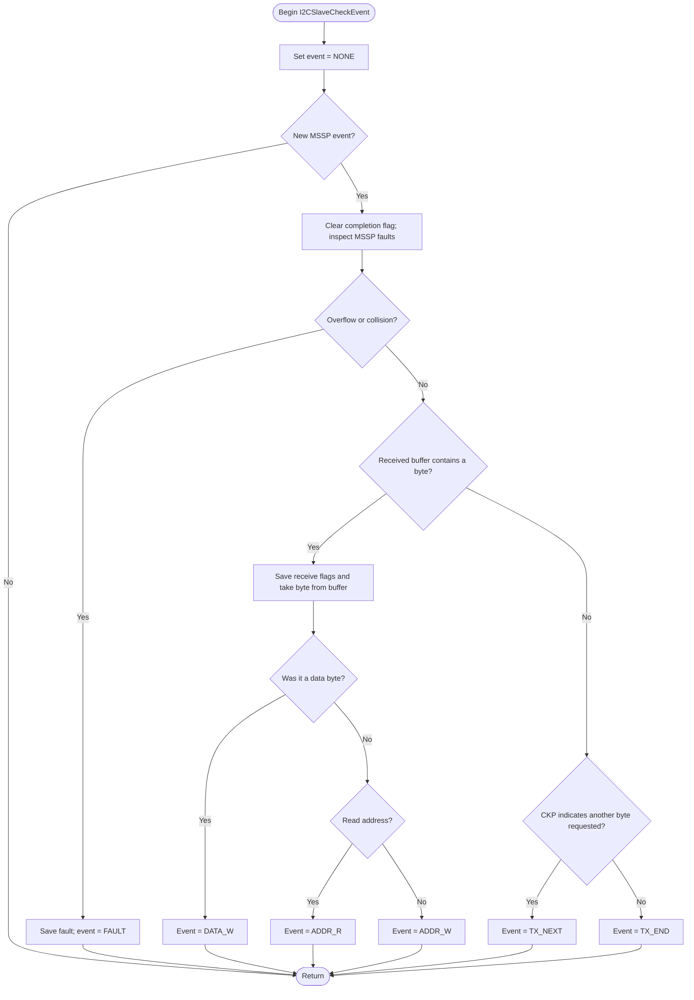
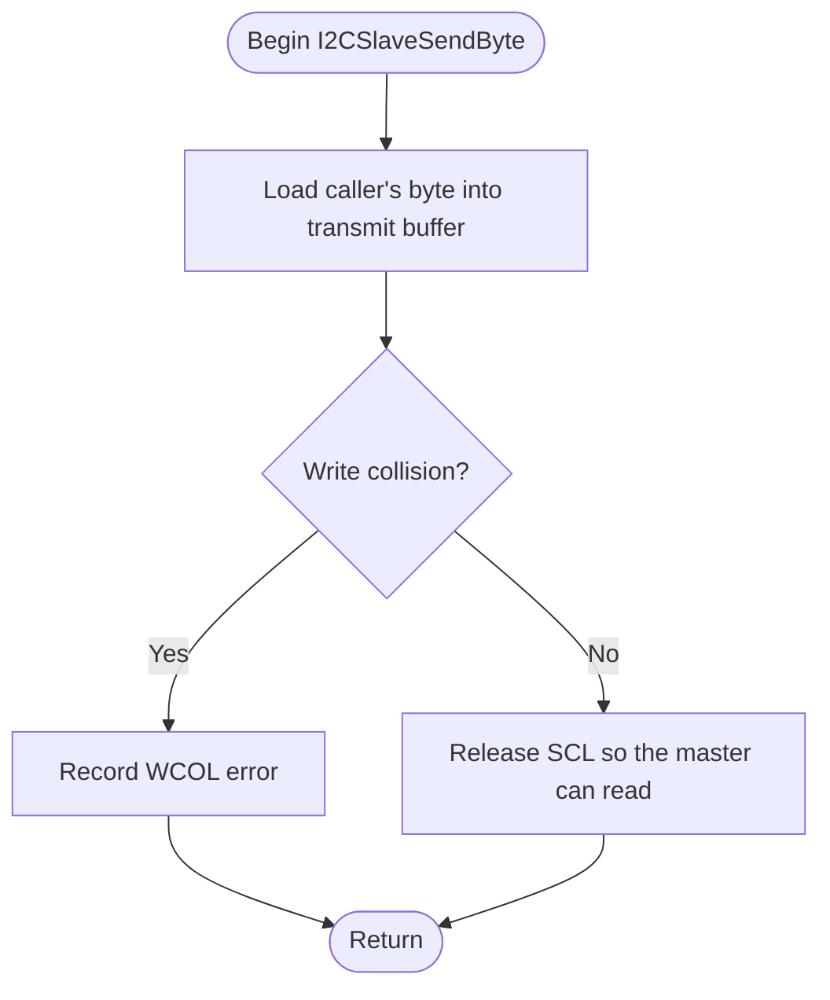
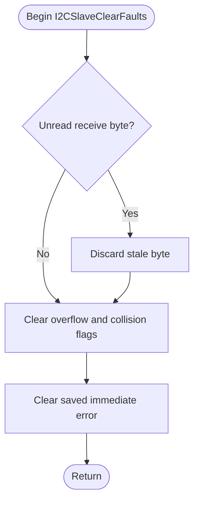
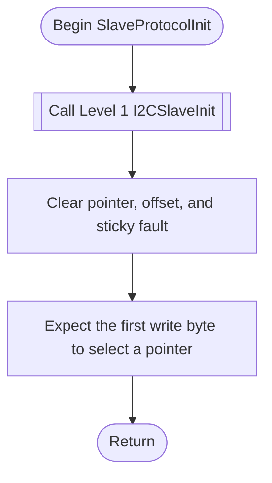
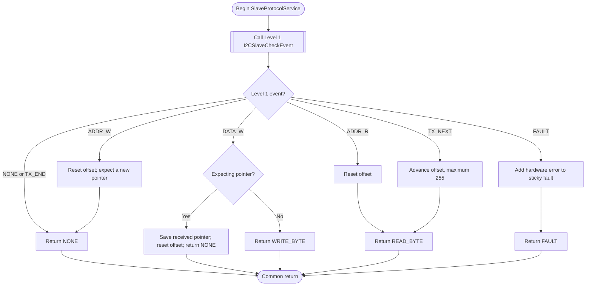
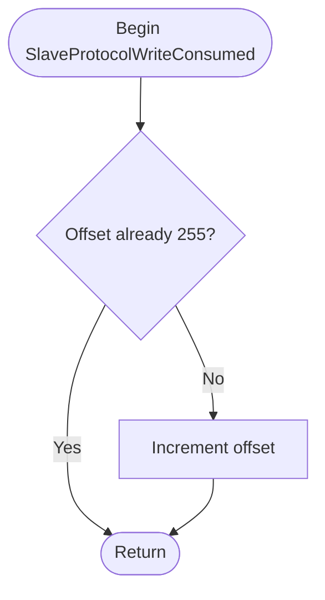
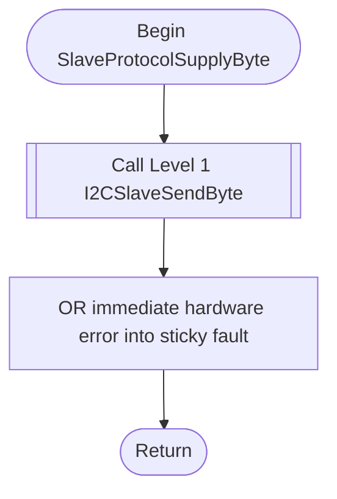
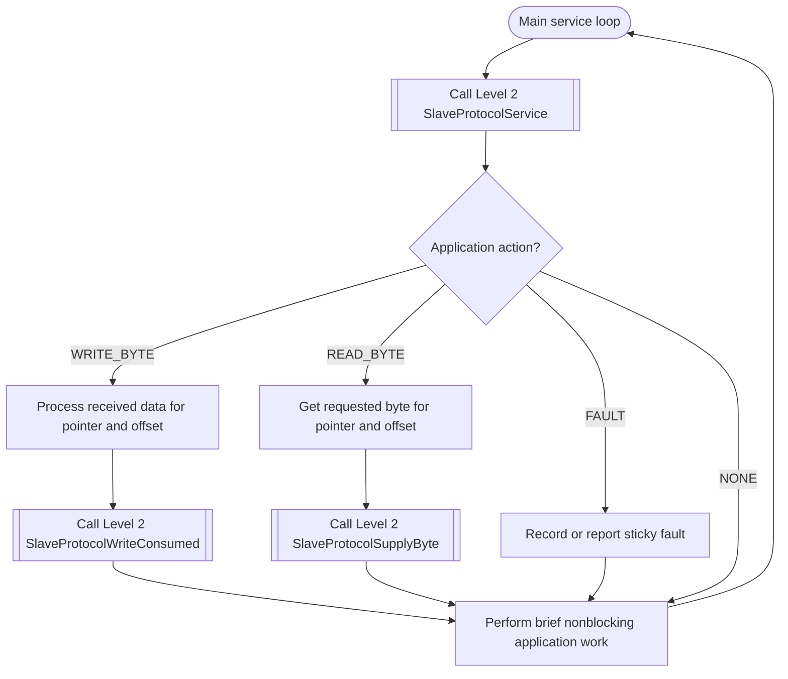

# Lab 10: Three-level I²C slave software design

**Optional design example | PIC16F883 | Lab 10 Part 3**

This guide suggests a way to organize a PIC16F883 **I²C slave**. It is not a required implementation. The [Lab 10 assignment](https://github.com/rosstimo/RCET3375/blob/main/LabAssignments/Lab10-I2C.md#part-3) defines the required behavior and evidence; you may organize your code differently if it meets those requirements.

The example is based on a tested **7-bit slave address of `0x20`** and an MSSP interface polled from the main loop. It focuses on the reusable I²C software, not a particular set of slave registers. It contains flowcharts and pseudocode, rather than complete PIC-AS routines. Keep any `.S` modules and application code organized as you prefer; a three-level design does not require three separate files.

## Contents

- [Why three levels?](#why-three-levels)
- [Shared state and interface](#shared-state-and-interface)
- [Level 1: MSSP hardware operations](#level-1-mssp-hardware-operations)
- [Level 2: Register-pointer protocol](#level-2-register-pointer-protocol)
- [Level 3: Application dispatch](#level-3-application-dispatch)
- [Bus transaction examples](#bus-transaction-examples)
- [Clock stretching and fault boundaries](#clock-stretching-and-fault-boundaries)
- [References](#references)

## Why three levels?

The slave receives requests at the master's initiative. The hardware notices addresses and bytes; a protocol interprets their sequence; an application decides what a selected register means.

| Level | Main job | Does not do |
| --- | --- | --- |
| **1: MSSP hardware** | Configure slave mode, classify hardware events, receive a byte, queue a transmit byte, manage hardware flags and clock release | Interpret register pointers, PORTB, ADC, or display data |
| **2: Register protocol** | Track the selected register and byte offset; report read/write requests to the application | Access MSSP SFRs or call an application routine |
| **3: Application** | Decide what to read or write, prepare bytes, stage application work | Manipulate SSPBUF, CKP, or SSPIF directly |



**Calls only point downward.** Level 2 does not call Level 3. Instead, it returns an action code, and Level 3 decides what to do next. That keeps the same Level 1 and Level 2 usable with different applications.

In the diagrams, `[[Call ...]]` identifies a call to a lower-level routine. A diagram represents **one routine** with a single entry and one common return. Exact branch labels and implementation details remain your choice.

## Shared state and interface

These names illustrate the verified design, not a required RAM map.

| State | Written by | Read by | Meaning |
| --- | --- | --- | --- |
| `slave_byte` | Level 1 | Levels 2 and 3 | Most recently received I²C byte |
| `slave_event` | Level 1 | Level 2 | Hardware event classification |
| `slave_error` | Level 1 | Level 2 | Recent MSSP overflow/collision indicators |
| `slave_pointer` | Level 2 | Level 3 | Selected logical register |
| `slave_offset` | Level 2 | Level 3 | Byte position inside that register |
| `slave_expect_pointer` | Level 2 | Level 2 | Whether the next write byte selects a register |
| `slave_fault_latch` | Level 2 | Level 3 | Sticky copy of hardware faults |

Level 1 reports one of these events:

| Event | Meaning |
| --- | --- |
| `SLAVE_NONE` | No new bus event |
| `SLAVE_ADDR_W` | Master addressed this slave to write |
| `SLAVE_DATA_W` | Master delivered a write data byte |
| `SLAVE_ADDR_R` | Master addressed this slave to read |
| `SLAVE_TX_NEXT` | Master ACKed a byte and wants another |
| `SLAVE_TX_END` | Master NACKed the last byte |
| `SLAVE_FAULT` | MSSP detected an overflow or write collision |

Level 2 returns a different set of actions to Level 3:

| Action | What Level 3 does |
| --- | --- |
| `SLAVE_APP_NONE` | Continue normal application work |
| `SLAVE_APP_WRITE_BYTE` | Consume `slave_byte` using the current pointer and offset; tell Level 2 when processed |
| `SLAVE_APP_READ_BYTE` | Obtain the requested byte, then hand it to Level 2 for transmission |
| `SLAVE_APP_FAULT` | Check the fault state and follow the application's error policy |

Do not confuse a **Level 1 event** with a **Level 2 application action**. The application should not need to decode MSSP bit fields itself. A call may modify W, STATUS, and bank selection; preserve data across calls when necessary. Make ownership of each GPR and exported routine explicit before implementing the design.

[Back to top](#lab-10-three-level-ic-slave-software-design)

## Level 1: MSSP hardware operations

Level 1 is the only layer that directly operates MSSP registers and flags. In the example, the slave address is `0x20` (the on-wire address bytes are `0x40` for write and `0x41` for read). The master, not the slave, generates START and STOP and chooses whether to ACK or NACK data it reads.

### Initialize: `I2CSlaveInit`

**Purpose:** Configure the hardware to recognize its seven-bit address and start with empty event/error state.



```text
Initialize the I²C slave.
    Configure the bus pins as digital inputs.
    Reset the peripheral configuration.
    Configure the slave address and normal clock release.
    Clear pending event and error state.
    Enable the peripheral.
    Return.
```

The tested configuration does not enable general call or **receive-side** clock stretching. The application can later enable a specific analog pin without changing Level 1's bus responsibilities.

### Check one event: `I2CSlaveCheckEvent`

**Purpose:** Return immediately if no event is pending; otherwise read and classify a single hardware event.



```text
Check for an I²C event.
    Start with event NONE.
    If no new event is pending, return.
    Clear the event notification.
    If the peripheral reports a fault, capture it and report FAULT.
    Otherwise, if a received byte is available:
        Save its flags and remove it from the buffer.
        Classify it as address-write, address-read, or data-write.
    Otherwise, classify the completed slave transmission:
        Master ACK requests another byte; master NACK ends the read.
    Return.
```

On a **receive** event, reading `SSPBUF` clears its buffer-full indication. On a transmit-completion event, do not read it as though another byte had arrived. The PIC16F88X slave-transmit erratum makes the `CKP` state important when distinguishing a master's ACK from NACK.

### Supply a byte: `I2CSlaveSendByte`

**Purpose:** Load the raw byte supplied in W into the transmit buffer and release SCL on success.



```text
Supply one byte for the master to read.
    Place the caller's byte in the transmit buffer.
    If the write collided with an active transfer, record a fault.
    Otherwise release the clock so transmission can continue.
    Return.
```

Do not queue another byte after `SLAVE_TX_END`. The master provides the read ACK/NACK; the slave does not generate it.

### Clear hardware faults: `I2CSlaveClearFaults`

**Purpose:** Clear the MSSP's receive-overflow and write-collision indicators after an explicit recovery decision. This routine does not retry a transaction.



```text
Clear the recorded hardware fault condition.
    If a stale byte remains in the receive buffer, discard it.
    Clear the peripheral's overflow and collision indicators.
    Clear the stored immediate hardware error.
    Return.
```

Clearing flags alone is not proof that the bus has recovered. For example, a slave stuck holding SCL low may need a separate, verified recovery procedure.

[Back to top](#lab-10-three-level-ic-slave-software-design)

## Level 2: Register-pointer protocol

Level 2 uses only Level 1 hardware routines. It interprets write bytes as a register selection followed by optional payload data. On a read, it requests application data by returning an action instead of calling an application callback.

### Initialize protocol: `SlaveProtocolInit`

**Purpose:** Initialize the hardware and start in a state expecting a register pointer on the next write.



```text
Initialize the protocol.
    Call Level 1 Initialize Slave.
    Clear the register pointer, byte offset, and sticky fault.
    Mark the next addressed write byte as a pointer.
    Return.
```

### Process one event: `SlaveProtocolService`

**Purpose:** Ask Level 1 for one event, update protocol bookkeeping, and return an action in W. This routine **never calls Level 3**.



```text
Process one hardware event.
    Call Level 1 Check Event.
    For a new addressed write, reset offset and expect a pointer.
    For write data:
        If a pointer is expected, save it, clear expectation, and reset offset.
        Otherwise return WRITE_BYTE without advancing offset.
    For a new addressed read, reset offset and return READ_BYTE.
    When the master ACKs a previous read byte, advance offset and return READ_BYTE.
    When the master NACKs, return NONE.
    On a hardware fault, update sticky fault status and return FAULT.
    Otherwise return NONE.
```

The selected pointer survives STOP. The byte offset stops increasing at `0xFF` instead of wrapping to zero. Level 2 does **not** decide whether the selected register exists or how many bytes it contains.

### Finish a payload write: `SlaveProtocolWriteConsumed`

**Purpose:** Let Level 3 tell Level 2 that it has processed the current received payload byte. This increments the offset for the **next** byte.



```text
After the application consumes a received payload byte:
    Advance the byte offset unless already at 255.
    Return.
```

This is a **software completion notification**, not an ACK bit on the I²C bus. With receive stretching disabled in the tested Level 1, this routine does not hold or release SCL.

### Supply a read byte: `SlaveProtocolSupplyByte`

**Purpose:** Accept a byte from Level 3 in W and pass it down to Level 1.



```text
Provide a byte requested by the master.
    Call Level 1 Send Byte with the application byte in W.
    Add any hardware error to the sticky fault report.
    Return.
```

The application should prepare the byte promptly: in a slave read, SCL may already be held LOW until Level 1 queues the byte and releases the clock.

[Back to top](#lab-10-three-level-ic-slave-software-design)

## Level 3: Application dispatch

Level 3 owns the main loop and all application-specific decisions. A PORTB input, a display character, an ADC conversion, or any future device-specific register belongs here, **not** in Level 2.



```text
Repeat forever:
    Call Level 2 Service Protocol.
    If a write byte is ready:
        Use pointer, offset, and received byte to perform application work.
        Call Level 2 Write Consumed.
    If a read byte is requested:
        Determine one byte from the selected pointer and offset.
        Call Level 2 Supply Byte with that value.
    If a fault was reported:
        Handle or report it according to the application's policy.
    Perform short, nonblocking background tasks.
```

The separate read and write application routines are permitted to use other peripherals. They should not directly read or write the MSSP registers. For multi-byte application values, ensure both bytes belong to the same sample; Level 2 cannot provide that consistency on its own.

## Bus transaction examples

These examples assume a seven-bit slave address of `0x20`. The master sends address byte `0x40` for write and `0x41` for read. Sample register pointers such as `0x10` and `0x11` are generic, not defined application registers.

| Master transaction | What Level 2 does | Level 3 action |
| --- | --- | --- |
| `START, 0x40, ACK, STOP` | Recognize addressed write and expect pointer | None |
| `START, 0x40, ACK, 0x10, ACK, STOP` | Save selected pointer `0x10` | None |
| `START, 0x41, ACK, byte, NACK, STOP` | Reset offset, return `READ_BYTE`, then `NONE` | Supply byte for pointer `0x10`, offset 0 |
| `START, 0x40, ACK, 0x11, ACK, 0x5A, ACK, STOP` | Save pointer `0x11`, return `WRITE_BYTE` for `0x5A` | Consume one write byte; notify Level 2 |
| `START, 0x41, ACK, high, ACK, low, NACK, STOP` | Request offsets 0 and 1 | Supply two successive application bytes |

The **master** controls the number of bytes read by choosing ACK after an intermediate byte and NACK after the final byte. A register pointer can be written in one transaction and read in a later transaction, even with STOP between them.

An unsupported pointer is an application decision. The slave hardware has usually **already ACKed** the address or received data by the time the program sees an event; software cannot retroactively NACK an unsupported register.

## Clock stretching and fault boundaries

At nominal 100 kHz, a bus byte and its ACK/NACK occupy approximately 90 µs. With the example's **receive stretching disabled**, the foreground polling loop must retrieve a received byte before the next one arrives. A long application handler can cause an overflow; this interface is not a receive queue.

During a **slave read**, the MSSP can hold SCL LOW until software supplies the next byte. The Part 3 experiment deliberately delays one application read to show this behavior and investigate the master's timeout. A master timeout is not proof that the slave has released the bus, and a master-side cleanup attempt cannot guarantee recovery from a slave that still holds a line LOW.

The interface reports hardware faults and preserves sticky fault information. It does not automatically retry, send a STOP (only the master can generate STOP), clear every fault, or recover an electrically stuck bus. A later interrupt-driven design must preserve interrupted context, protect shared application data, and assign SSPIF handling to one owner. Do not enable receive clock stretching without testing an explicit clock-release path.

When implementing this design, verify correct and incorrect address responses, pointer persistence, a one-byte read ending in NACK, multiple read bytes ending in NACK, a payload write, and normal status reporting with a logic analyzer or oscilloscope. Use the lab assignment for the required applications, measurements, and demonstration conditions.

## References

- [PIC16F882/883/884/886/887 Data Sheet (Microchip)](https://ww1.microchip.com/downloads/en/DeviceDoc/40001291H.pdf), especially MSSP slave mode, `SSPCON`, `SSPSTAT`, `SSPBUF`, `SSPADD`, `SSPIF`, and `CKP`.
- [PIC16F88X Silicon Errata (Microchip)](https://ww1.microchip.com/downloads/en/DeviceDoc/80000302J.pdf), especially the slave-transmit ACK/NACK behavior.
- [RCET3375 Lab 10 assignment](https://github.com/rosstimo/RCET3375/blob/main/LabAssignments/Lab10-I2C.md), Part 3.

[Back to top](#lab-10-three-level-ic-slave-software-design)