<a id="top"></a>
# Lab10: Three-level I²C software design

**Optional design example | PIC16F883 and ADS1115 | Lab10, through Part 2**

This is **one suggested way** to organize an I²C master, not a required implementation or a complete walkthrough of Part 2. Students may use, adapt, or replace this design; the lab instructions define the required work. The guide illustrates MSSP operations, I²C transactions, and selected ADS1115 application operations through descriptions, flowcharts, pseudocode, and bus sequences. 

## Table of contents

- [Lab10: Three-level I²C software design](#lab10-three-level-ic-software-design)
  - [Table of contents](#table-of-contents)
  - [Philosophy: why three levels?](#philosophy-why-three-levels)
  - [Reading flowcharts and pseudocode](#reading-flowcharts-and-pseudocode)
  - [Level 1: MSSP operations](#level-1-mssp-operations)
    - [Boundary](#boundary)
    - [Initialize MSSP](#initialize-mssp)
    - [START](#start)
    - [Send one byte](#send-one-byte)
    - [Receive one byte](#receive-one-byte)
    - [ACK or NACK a received byte](#ack-or-nack-a-received-byte)
    - [STOP](#stop)
    - [Shared wait](#shared-wait)
    - [Limits and verification](#limits-and-verification)
  - [Level 2: Transactions](#level-2-transactions)
    - [Boundary and interface](#boundary-and-interface)
      - [Shared RAM interface](#shared-ram-interface)
    - [Initialize through Level 2: `I2CTransactionInit`](#initialize-through-level-2-i2ctransactioninit)
      - [Flowchart](#flowchart)
      - [Pseudocode](#pseudocode)
    - [Write transaction: `I2CWriteTransaction`](#write-transaction-i2cwritetransaction)
      - [Flowchart](#flowchart-1)
      - [Pseudocode](#pseudocode-1)
    - [Read transaction: `I2CReadTransaction`](#read-transaction-i2creadtransaction)
      - [Flowchart](#flowchart-2)
      - [Pseudocode](#pseudocode-2)
    - [Finish transaction: `I2CFinishTransaction`](#finish-transaction-i2cfinishtransaction)
      - [Flowchart](#flowchart-3)
      - [Pseudocode](#pseudocode-3)
    - [Application and verification](#application-and-verification)
  - [Level 3: ADS1115 application](#level-3-ads1115-application)
    - [Boundary and interface](#boundary-and-interface-1)
      - [Hardware and memory setup](#hardware-and-memory-setup)
    - [Startup: `Setup`](#startup-setup)
      - [Flowchart](#flowchart-4)
      - [Pseudocode](#pseudocode-4)
    - [Main loop and configuration failure](#main-loop-and-configuration-failure)
      - [Flowchart](#flowchart-5)
      - [Pseudocode](#pseudocode-5)
    - [Configure ADS1115: `ConfigureADS1115`](#configure-ads1115-configureads1115)
      - [Flowchart](#flowchart-6)
      - [Pseudocode](#pseudocode-6)
      - [I²C transaction sequence](#ic-transaction-sequence)
    - [Read conversion: `ReadConversion`](#read-conversion-readconversion)
      - [Flowchart](#flowchart-7)
      - [Pseudocode](#pseudocode-7)
      - [I²C transaction sequence](#ic-transaction-sequence-1)
    - [Display result: `ShowResult`](#display-result-showresult)
      - [Flowchart](#flowchart-8)
      - [Pseudocode](#pseudocode-8)
    - [Limits and verification](#limits-and-verification-1)
  - [References](#references)

## Philosophy: why three levels?

The PIC hardware, the I²C protocol, and the application each answer a different question. A good program keeps those decisions apart so that an operation can be understood and tested without also following every detail of the rest of the system.

| Level | Question it answers | Responsibility | What it does not interpret |
| --- | --- | --- | --- |
| **1: MSSP operations** | How do we operate the bus? | Configure MSSP; START; STOP; send/receive one byte; ACK/NACK; wait for completion | Target addresses, register pointers, or ADS1115 settings |
| **2: Transactions** | How do we exchange a complete message? | Build address bytes from seven-bit addresses; transfer buffers; check acknowledgments; finish transactions | ADS1115 registers or what the data represents |
| **3: Application** | What do we communicate, and when? | Configure the ADS1115; select registers; read conversions; schedule reads; display results | PIC MSSP control registers and raw-byte transfer details |

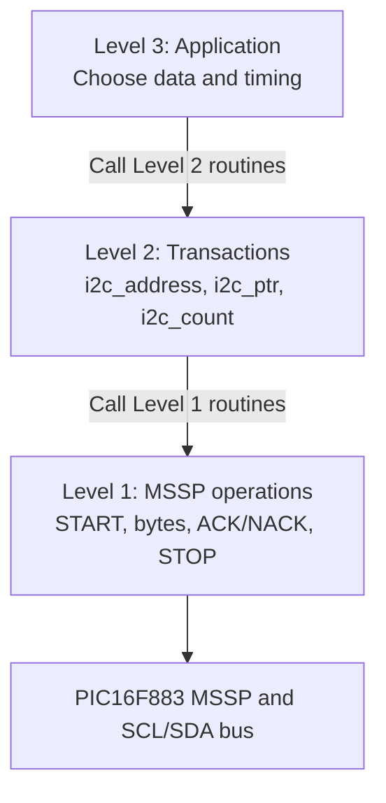

Each level calls the **next lower level**, not a lower level two steps away. The application uses Level 2 rather than manipulating MSSP registers directly. Level 1 knows nothing about the ADS1115. Status values travel upward so the application can respond to errors.

**Levels are logical divisions, not required source-file divisions.** All three levels may be implemented in one PIC-AS source file or organized into multiple source files. What matters is keeping each routine's responsibility and interface clear.

This example favors small, direct routines for a single master. Its operations wait for the MSSP to finish, and it does not include automatic retry, collision recovery, repeated START, or any guarantee that a timed-out bus has recovered.

[Back to top](#top)

## Reading flowcharts and pseudocode

Each routine follows the same sequence: **description and interface, flowchart, pseudocode**. Follow the diagrams from Level 3 down through the calls into Level 2 and Level 1.

Keep two types of acknowledgment distinct: the **target** ACKs a byte transmitted by the PIC (master); the **PIC** ACKs a received byte when it wants more data and NACKs the final byte. An address such as `0x48` is a seven-bit target address, while the raw bytes `0x90` and `0x91` are the corresponding eight-bit write and read bus bytes.

The byte sequences below show the example with ADS1115 ADDR grounded. **Use the seven-bit address you actually confirm** with the Part 1 address probe when implementing the lab.

[Back to top](#top)
<a id="level-1-mssp-operations"></a>
## Level 1: MSSP operations

<a id="level-1-boundary"></a>
### Boundary

Level 1 controls MSSP registers and sends or receives **one raw byte** at a time. It does not interpret slave addresses, register pointers, byte counts, or ADS1115 commands. A caller checks `i2c_status` after each operation. Level 1 never automatically issues STOP after an error.

| Routine | Input | Output / behavior |
| --- | --- | --- |
| `I2CInit` | None | Initialize MSSP master |
| `I2CStart` | None | Generate START; check SCL/SDA first |
| `I2CSendByte` | Raw 8-bit byte in W | Transmit byte; check slave ACK/NACK |
| `I2CReadByte` | None | Receive one byte into `i2c_byte` |
| `I2CAck` | None | Master ACK: request another read byte |
| `I2CNack` | None | Master NACK: finish reading |
| `I2CStop` | None | Generate STOP |
| `I2CWait` | MSSP operation in progress | Wait for `SSPIF` with a bounded loop and timeout |

The interface uses these status values: `0` = OK; `1` = NACK; `2` = timeout (SCL high); `3` = bus low before START; `4` = timeout (SCL low). Codes `2` and `4` describe the observed condition at timeout, not the cause. These routines do not detect bus collisions or recover a stuck bus.

| Value | Status name | Meaning |
| ---: | --- | --- |
| 0 | `I2C_OK` | Completed successfully |
| 1 | `I2C_NACK` | Slave did not acknowledge |
| 2 | `I2C_TIMEOUT` | Wait expired with SCL high |
| 3 | `I2C_BUS_LOW` | SCL or SDA low before START |
| 4 | `I2C_SCL_LOW` | Wait expired with SCL low |

SCL is RC3, SDA is RC4; both require suitable external pull-ups. Calls change W, STATUS flags, and bank selection. The caller is responsible for valid operation order.


[Back to top](#top)

<a id="level-1-initialize-mssp"></a>
### Initialize MSSP

The I²C routines need the MSSP configured before they can use the bus. This sets RC3/RC4 as inputs, selects the 100 kHz clock divider, and enables master mode.

**Use:** Call once during setup, before any transfer. **Input:** None; assumes a 4 MHz oscillator and external pull-ups. **Output:** MSSP configured; `i2c_status` is unchanged.

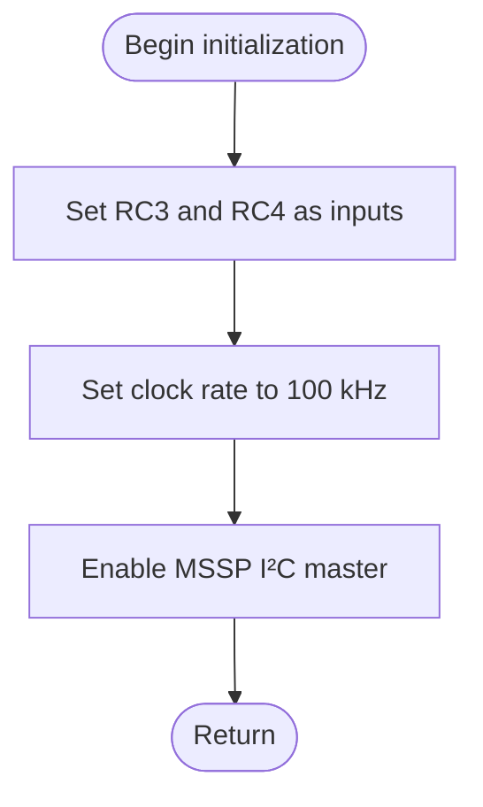

```text
Initialize MSSP
    Configure SCL and SDA as inputs.
    Set the MSSP clock rate.
    Enable I²C master mode.
    Return.
```


[Back to top](#top)

<a id="level-1-start"></a>
### START

A transaction begins with START. The routine checks that SCL and SDA are high, then requests START through the MSSP and waits for completion.

**Use:** Call at the beginning of a new transaction. **Input:** No parameters; the bus should be idle. **Output:** `i2c_status` is OK, BUS_LOW, TIMEOUT, or SCL_LOW.

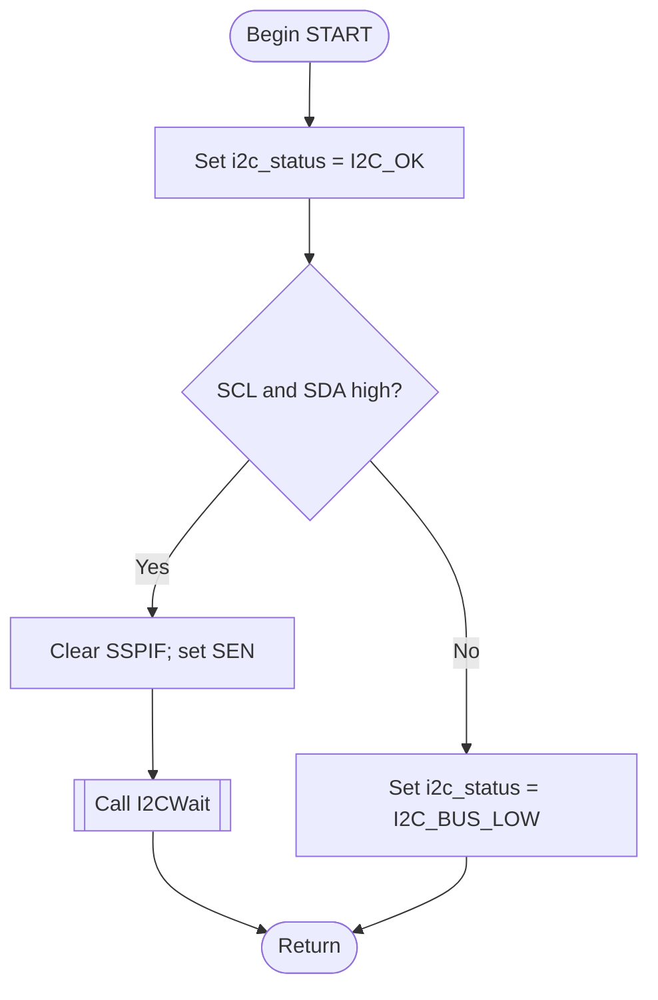

```text
START
    Set i2c_status = I2C_OK.
    If either bus line is low, set i2c_status = I2C_BUS_LOW and return.
    Clear SSPIF and request START.
    Use I2CWait to wait for completion, then return.
```


[Back to top](#top)

<a id="level-1-send-one-byte"></a>
### Send one byte

The master must transmit address and data bytes using the same hardware operation. This routine writes W to `SSPBUF`, waits for transmission, and checks the slave's ACK bit. Level 1 does not shift or interpret the byte.

**Use:** Call after START or a previously ACKed byte. **Input:** The raw eight-bit bus byte in W. **Output:** `i2c_status` is OK, NACK, TIMEOUT, or SCL_LOW.

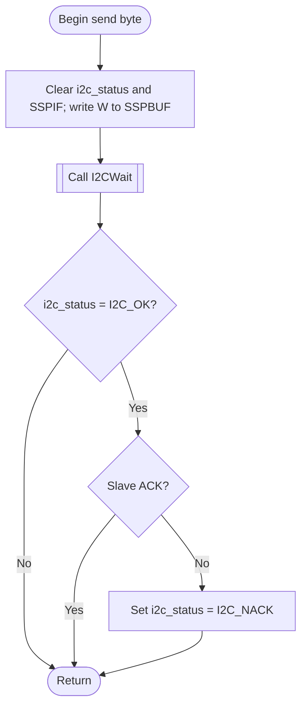

```text
Send Byte
    Clear i2c_status and SSPIF.
    Write the supplied byte in W to SSPBUF.
    Call I2CWait; return if i2c_status is not I2C_OK.
    If the slave did not acknowledge the byte, set i2c_status = I2C_NACK.
    Return.
```


[Back to top](#top)

<a id="level-1-receive-one-byte"></a>
### Receive one byte

After the master sends a read address, it must clock a byte in from the slave. This routine enables MSSP reception, waits for eight bits, and copies `SSPBUF` into RAM.

**Use:** Call after an ACKed read address or after acknowledging a previous received data byte. **Input:** None. **Output:** On success, `i2c_byte` contains the received byte and `i2c_status` is OK; on failure, the previous `i2c_byte` is unchanged and `i2c_status` is TIMEOUT or SCL_LOW.

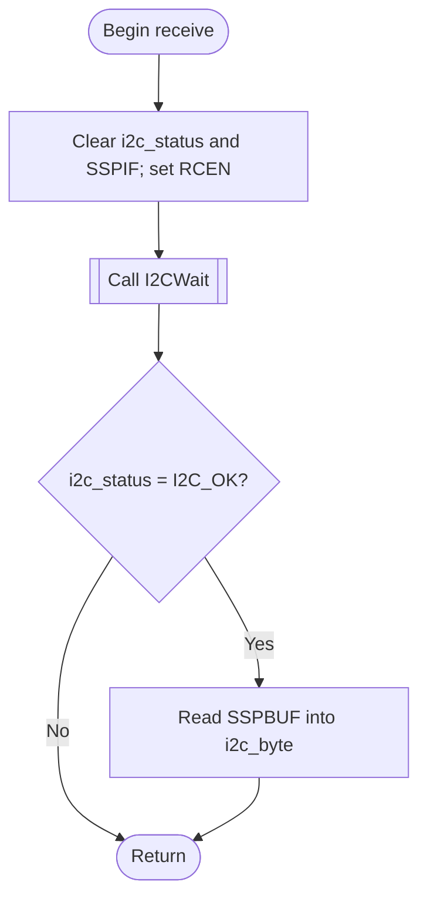

```text
Receive Byte
    Clear i2c_status and SSPIF.
    Enable receive and call I2CWait.
    If i2c_status = I2C_OK, save SSPBUF in i2c_byte.
    Return.
```


[Back to top](#top)

<a id="level-1-ack-or-nack-a-received-byte"></a>
### ACK or NACK a received byte

After reading a byte, the master tells the slave whether another byte is wanted. `I2CAck` sets `ACKDT=0`; `I2CNack` sets `ACKDT=1`. Both request the response clock through `ACKEN`.

**Use:** Call `I2CAck` after a received byte when more bytes remain; call `I2CNack` after the final byte. **Input:** No parameters; choose the routine. **Output:** `i2c_status` is OK, TIMEOUT, or SCL_LOW.

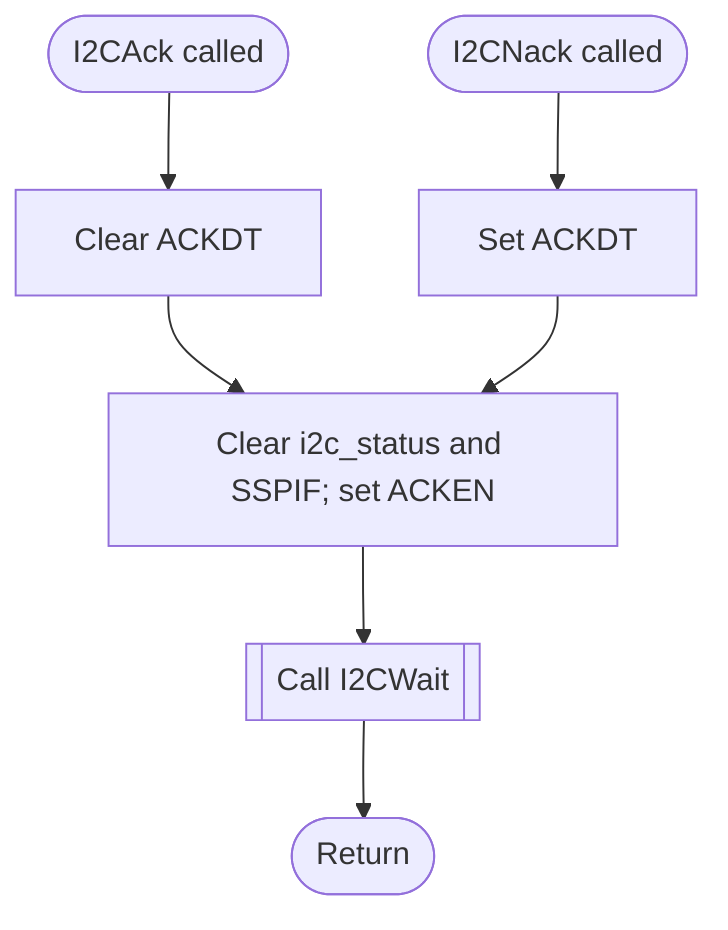

```text
Send ACK
    Set ACKDT to zero.
    Clear i2c_status and SSPIF; set ACKEN.
    Use I2CWait to wait for completion, then return.

Send NACK
    Set ACKDT to one.
    Clear i2c_status and SSPIF; set ACKEN.
    Use I2CWait to wait for completion, then return.
```


[Back to top](#top)

<a id="level-1-stop"></a>
### STOP

A completed transaction needs STOP to release the bus. This routine requests the MSSP STOP condition and waits for its completion.

**Use:** Call while the master still controls an active transaction, normally after the final byte or an ordinary NACK. **Input:** None. **Output:** `i2c_status` is OK, TIMEOUT, or SCL_LOW; a timeout does not prove the bus was released. There may be a problem with the bus or a slave may still be holding SCL low.

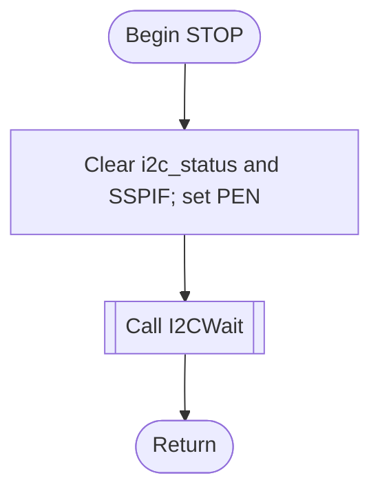

```text
STOP
    Clear i2c_status and SSPIF.
    Request STOP, use I2CWait to wait for completion, then return.
```


[Back to top](#top)

<a id="level-1-shared-wait"></a>
### Shared wait

MSSP operations take time to complete. In i2c master mode `SSPIF` is set after various operations, including START, STOP, end of receive, and ACK/NACK, however; simply waiting for `SSPIF` to be set can lead to indefinite blocking and may be irecoverable without a device reset. This common routine polls `SSPIF` with a 255-count limit and checks SCL only if the limit expires. It avoids a separate polling loop in every Level 1 routine.

**Use:** Called internally by level 1 routines after requesting an MSSP operation. **Input:** Caller starts operation, clears `SSPIF`, and initializes `i2c_status`. **Output:** Status is unchanged on completion; on timeout `i2c_status` becomes TIMEOUT or SCL_LOW.

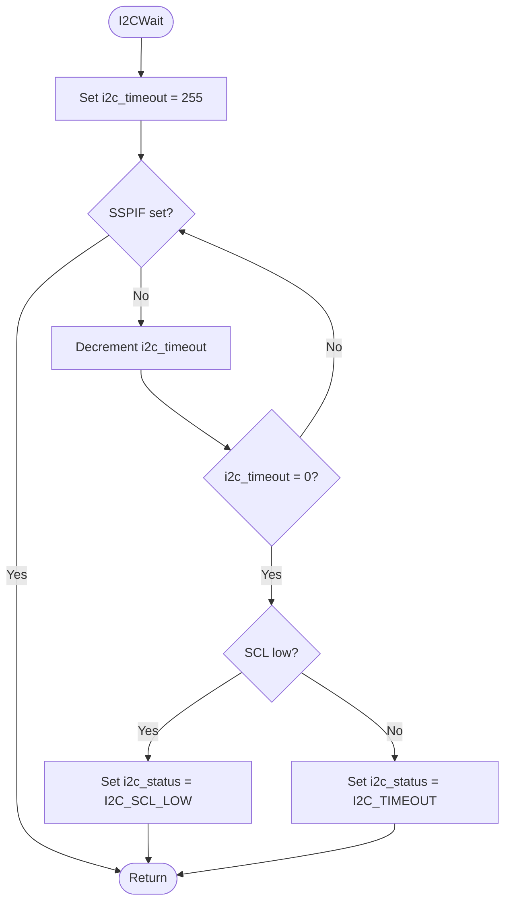

```text
Wait
    Set i2c_timeout = 255.
    Check SSPIF; if not set, decrement i2c_timeout and repeat until it reaches zero.
    If SSPIF is set, return with i2c_status unchanged.
    If i2c_timeout reaches zero, set i2c_status = I2C_SCL_LOW if SCL is low, or I2C_TIMEOUT otherwise.
    Return.
```


[Back to top](#top)

[Back to top](#top)

<a id="level-1-limits-and-verification"></a>
### Limits and verification

- A valid call sequence and a single-master bus are assumed. No collision handling, automatic recovery, retries, or repeated START are included. This design uses STOP followed by a new START.
- The software counter is an iteration limit, not a calibrated millisecond timeout. A stalled transfer leaves transaction state uncertain.
- Test the operation order, ACK/NACK responses, timeout conditions, and STOP behavior on hardware before relying on the interface.

[Back to top](#top)

---

<a id="level-2-transactions"></a>
## Level 2: Transactions

<a id="level-2-boundary-and-interface"></a>
### Boundary and interface

Level 2 assembles whole I²C transactions using [Level 1 MSSP operations](#level-1-mssp-operations). It encodes a seven-bit address, sends or receives bytes, decides which response to send after a received byte, and finishes the transaction.

Level 2 does not touch MSSP registers or interpret ADS1115 register values. Level 3 chooses the device, data, destination buffer, and when to communicate.

| Subroutine | Action |
| --- | --- |
| `I2CTransactionInit` | Initialize the underlying MSSP through Level 1; call once before any transactions |
| `I2CWriteTransaction` | Write zero or more bytes; zero bytes probes the address |
| `I2CReadTransaction` | Read one or more bytes; **`i2c_count` must be at least 1** |
| `I2CFinishTransaction` | Save the result and send STOP after success or ordinary NACK |

| Variable | Bank 0 address | Input or output |
| --- | --- | --- |
| `i2c_address` | `0x36` | Input: seven-bit address; not changed |
| `i2c_ptr` | `0x37` | Input: buffer address; advances after each completed data byte |
| `i2c_count` | `0x38` | Input: number of data bytes; decreases after each completed data byte |
| `i2c_result` | `0x39` | Output: transaction status |

`i2c_status` and `i2c_byte` belong to Level 1. The application uses only the Level 2 entry points and `i2c_result`, including `I2CTransactionInit` rather than calling `I2CInit` directly. These interfaces work whether the routines are kept in one source file or split into several. Buffers must fit in contiguous bank 0 GPRs without overlapping working variables. The caller supplies a valid buffer and count. Level 2 changes W, STATUS, bank selection, FSR, and IRP; it is not reentrant.

The seven-bit address `0x48` is sent as `0x90` for write or `0x91` for read. Level 1 sends these already encoded bytes unchanged.

After an operation returns `I2C_OK` or `I2C_NACK`, the finish routine requests STOP. After `I2C_TIMEOUT`, `I2C_BUS_LOW`, or `I2C_SCL_LOW`, it returns the error without assuming STOP can finish an incomplete transfer. A STOP error replaces the earlier transaction result. Recovery and retries are outside this design.

`I2CTransactionInit`, `I2CWriteTransaction`, and `I2CReadTransaction` each have one entry and one common exit. Both call `I2CFinishTransaction`, which also has one entry and one exit.

<a id="level-2-shared-ram-interface"></a>
#### Shared RAM interface

Level 2 exposes the four RAM locations and public result values `I2C_RESULT_OK` (0), `I2C_RESULT_NACK` (1), `I2C_RESULT_TIMEOUT` (2), `I2C_RESULT_BUS_LOW` (3), and `I2C_RESULT_SCL_LOW` (4). These symbolic names can be defined in the same source file as the routines or shared through an interface file when using multiple modules. Regardless of file layout, Level 2 depends on Level 1 operations, while Level 1 is independent of Levels 2 and 3.


[Back to top](#top)

<a id="level-2-initialize-through-level-2-i2ctransactioninit"></a>
### Initialize through Level 2: `I2CTransactionInit`

The application needs to initialize the MSSP without knowing a Level 1 routine name. This one-call wrapper preserves the direction of dependencies: Level 3 calls Level 2, and Level 2 calls Level 1.

**Use:** Call once after configuring the application's analog/digital pins, before any transaction. **Input:** None. **Output:** MSSP initialized by Level 1; `i2c_result` remains unchanged.

<a id="level-2-flowchart"></a>
#### Flowchart

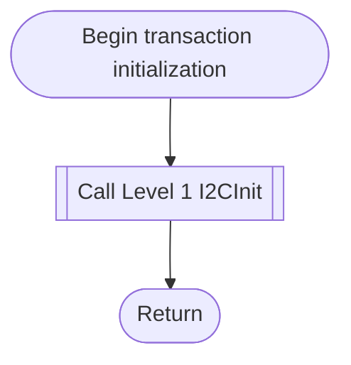

<a id="level-2-pseudocode"></a>
#### Pseudocode

```text
Initialize transactions
    Call Level 1 Initialize MSSP.
    Return.
```


[Back to top](#top)

<a id="level-2-write-transaction-i2cwritetransaction"></a>
### Write transaction: `I2CWriteTransaction`

A write sends an address followed by zero or more bytes. This routine formats the seven-bit address with the write bit, calls Level 1 for each transfer, and finishes at the first error or after the last byte.

**Use:** Write data to a slave, or probe its address with a count of zero. **Inputs:** `i2c_address`, `i2c_ptr`, and `i2c_count` (a zero count needs no buffer). **Outputs:** `i2c_result` gives the transaction status; the pointer advances and the count decreases only for ACKed data bytes.

<a id="level-2-flowchart-2"></a>
#### Flowchart

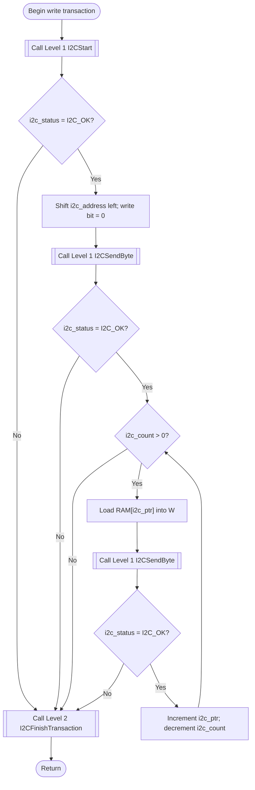

<a id="level-2-pseudocode-2"></a>
#### Pseudocode

```text
Write Transaction
    Call Level 1 START.
    If i2c_status is not I2C_OK, go to Finish.

    Shift i2c_address left one bit; set write bit to zero.
    Call Level 1 Send Byte with the resulting address byte.
    If i2c_status is not I2C_OK, go to Finish.

    While i2c_count > 0:
        Load RAM[i2c_ptr] into W.
        Call Level 1 Send Byte.
        If i2c_status is not I2C_OK, go to Finish.
        Increment i2c_ptr.
        Decrement i2c_count.

Finish
    Call Level 2 Finish Transaction.
    Return.
```


[Back to top](#top)

<a id="level-2-read-transaction-i2creadtransaction"></a>
### Read transaction: `I2CReadTransaction`

A read collects one or more bytes from a slave. This routine formats the address with the read bit, stores received bytes in RAM, ACKs intermediate bytes, and NACKs the last byte.

**Use:** Read a known number of bytes after Level 3 selects the desired device register, if required. **Inputs:** `i2c_address`, `i2c_ptr` (destination buffer), and `i2c_count` (**at least 1**). **Outputs:** Received bytes in the buffer, `i2c_result` as the transaction status, and updated pointer/count for bytes successfully received.

<a id="level-2-flowchart-3"></a>
#### Flowchart

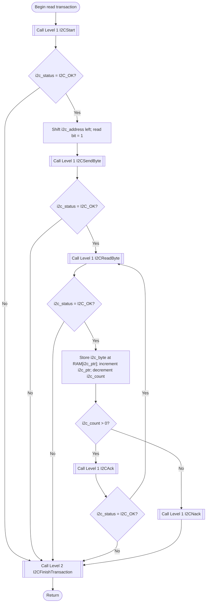

<a id="level-2-pseudocode-3"></a>
#### Pseudocode

```text
Read Transaction (i2c_count is at least 1)
    Call Level 1 START.
    If i2c_status is not I2C_OK, go to Finish.

    Shift i2c_address left one bit and set the read bit.
    Call Level 1 Send Byte with the resulting address byte.
    If i2c_status is not I2C_OK, go to Finish.

Read Next Byte
    Call Level 1 Read Byte.
    If i2c_status is not I2C_OK, go to Finish.
    Store i2c_byte at RAM[i2c_ptr].
    Increment i2c_ptr.
    Decrement i2c_count.

    If i2c_count > 0:
        Call Level 1 ACK.
        If i2c_status is not I2C_OK, go to Finish.
        Go to Read Next Byte.
    Otherwise:
        Call Level 1 NACK.

Finish
    Call Level 2 Finish Transaction.
    Return.
```


[Back to top](#top)

<a id="level-2-finish-transaction-i2cfinishtransaction"></a>
### Finish transaction: `I2CFinishTransaction`

Read and write transactions need the same exit behavior. This helper saves the last Level 1 status before STOP can overwrite it, requests STOP after OK or NACK, and leaves uncertain timeout cases alone.

**Use:** Called by both Level 2 transaction routines at their common exit. **Input:** `i2c_status` from the last Level 1 operation. **Output:** `i2c_result` preserves that status unless STOP fails, in which case it reports the STOP error.

<a id="level-2-flowchart-4"></a>
#### Flowchart

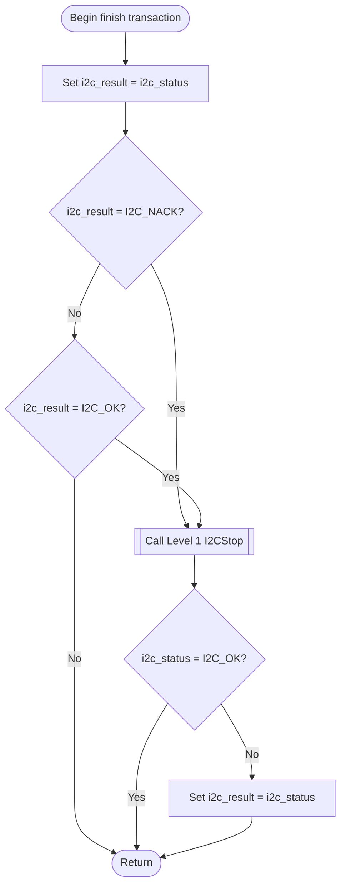

<a id="level-2-pseudocode-4"></a>
#### Pseudocode

```text
Finish Transaction
    Set i2c_result = i2c_status.
    If i2c_result is I2C_OK or I2C_NACK:
        Call Level 1 STOP.
        If i2c_status is not I2C_OK, set i2c_result = i2c_status.
    Return.
```


[Back to top](#top)

[Back to top](#top)

<a id="level-2-application-and-verification"></a>
### Application and verification

Level 3 chooses ADS1115 register pointers, Config bytes, when to read, and how to handle the result. In this example, it writes the Config pointer `0x01` and the two student-selected Config bytes once at startup, then writes the Conversion pointer `0x00` and performs a separate two-byte read. Level 2 does not know those values or combine the two transactions.

Check buffer addresses, ACK/NACK handling, timing, and error cases against the flowcharts and pseudocode. A successful address probe alone does not verify an entire transaction.

[Back to top](#top)

---

<a id="level-3-ads1115-application"></a>
## Level 3: ADS1115 application

<a id="level-3-boundary-and-interface"></a>
### Boundary and interface

Level 3 is the application. It decides **which ADS1115 register to access, which bytes to send, where readings are stored, when to take readings, and what to do with transaction results**. It calls [Level 2 transaction routines](#level-2-transactions), never [Level 1 MSSP routines](#level-1-mssp-operations).

| Entry / routine | Purpose |
| --- | --- |
| `Setup` | Prepare digital I/O, initialize I²C, configure ADS1115, and start Timer1 |
| `MainLoop` | Wait for Timer1 overflow and request one conversion read |
| `ConfigFailed` | Hold the displayed configuration error until reset |
| `ConfigureADS1115` | Send the ADS1115 Config register pointer and two configuration bytes |
| `ReadConversion` | Select the Conversion register, then read two bytes |
| `ShowResult` | Copy Level 2 transaction result to PORTA |

The only Level 2 entry points called are `I2CTransactionInit`, `I2CWriteTransaction`, and `I2CReadTransaction`. The application supplies `i2c_address`, `i2c_ptr`, and `i2c_count`; Level 2 returns `i2c_result`. Level 3 does not manipulate MSSP registers or format the wire address.

<a id="level-3-hardware-and-memory-setup"></a>
#### Hardware and memory setup

- PIC16F883 with a **4 MHz crystal**. SCL is RC3 (pin 14); SDA is RC4 (pin 15). Use suitable I²C pull-ups and a common ground.
- In the examples, ADS1115 ADDR is tied to GND, giving seven-bit address `0x48`. Determine the address of your own module with the Part 1 probe, then use the address you confirmed.
- A potentiometer feeds AIN0, with its ends connected to the ADS1115 supply and ground. Keep AIN0 within the ADS1115 supply rails.
- RA2:RA0 display the **three-bit transaction result**. Values: `0` OK, `1` NACK, `2` timeout with SCL high, `3` bus low before START, `4` timeout with SCL low.
- The ADC result is stored in two RAM bytes, most significant byte first. They are valid as a **complete pair only if the two-byte read succeeds**.

**PIC16F883, 28-pin PDIP (top view):**

```text
                        .-------U-------.
MCLR / PICkit         1 |               | 28 RB7 / PICkit PGD
Status bit 0          2 | RA0       RB6 | 27 PICkit PGC
Status bit 1          3 | RA1       RB5 | 26
Status bit 2          4 | RA2       RB4 | 25
                      5 | RA3       RB3 | 24
                      6 | RA4       RB2 | 23
                      7 | RA5       RB1 | 22
GND                   8 | VSS       RB0 | 21
4 MHz crystal         9 | OSC1      VDD | 20 +5 V
4 MHz crystal        10 | OSC2      VSS | 19 GND
                     11 | RC0       RC7 | 18
                     12 | RC1       RC6 | 17
                     13 | RC2       RC5 | 16
SCL + pull-up        14 | RC3       RC4 | 15 SDA + pull-up
                        '---------------'
```

**ADS1115 breakout, logical pin connections** (signal map only; pin order varies by module):

```text
                  .-----------------------.
PIC RC3 (14) ---- | SCL               VDD | ---- compatible supply
PIC RC4 (15) ---- | SDA               GND | ---- common ground
Confirmed ADDR -- | ADDR             AIN0 | <--- potentiometer wiper
  connection      |                   AIN1 | ---- not used
 Optional test -- | ALERT/RDY         AIN2 | ---- not used
                  |                   AIN3 | ---- not used
                  '-----------------------'

Potentiometer ends: ADS1115 VDD and GND
SCL and SDA:       pull up to a compatible I2C logic voltage
ADDR:              GND gives 7-bit address 0x48 in this example
ALERT/RDY:         not used by this example application
```

The Part 1 address probe determines the actual target address to use. Check the breakout's labeled pins and operating voltage before wiring it.

| Symbol | RAM address / value | Meaning |
| --- | --- | --- |
| `ADS_ADDRESS` | `0x48` | Seven-bit ADS1115 address for this test |
| `adc_msb` / `adc_lsb` | `0x34` / `0x35` | Conversion result bytes |
| `config_register` | `0x40` | ADS1115 Config register pointer, `0x01` |
| `config_msb` / `config_lsb` | `0x41` / `0x42` | Config bytes selected from the ADS1115 datasheet |
| `conversion_ptr` | `0x43` | Conversion register pointer, `0x00` |

These application buffers are contiguous bank-0 GPRs and do not overlap the Level 2 interface (`0x36`–`0x39`). The three levels describe how the program is organized logically; separate source files are optional.


[Back to top](#top)

<a id="level-3-startup-setup"></a>
### Startup: `Setup`

The application must disable analog functions on the PIC pins used for I/O, make the three status pins outputs, and initialize the transaction layer before using the ADS1115. Configuration is written once after reset. Only a successful configuration transaction allows periodic reads.

**Use:** Entered by the reset vector, not a callable subroutine. **Input:** Reset state, connected ADS1115 at `ADS_ADDRESS`. **Output:** RA2:RA0 configured, Level 2 initialized, ADS1115 Config write attempted; either Timer1 restarts or execution branches to the failure hold.

<a id="level-3-flowchart"></a>
#### Flowchart

~~~mermaid
flowchart TD
    BeginSetup([Reset enters Setup]) --> DigitalPins["Disable analog inputs and comparators"]
    DigitalPins --> StatusPins["Clear PORTA; make RA0 through RA2 outputs"]
    StatusPins --> InitTransaction[[Call Level 2 I2CTransactionInit]]
    InitTransaction --> SetAddress["Set i2c_address = ADS_ADDRESS"]
    SetAddress --> Configure[[Call Level 3 ConfigureADS1115]]
    Configure --> ConfigOK{"i2c_result = I2C_RESULT_OK?"}
    ConfigOK -->|No| Failed["Go to ConfigFailed"]
    ConfigOK -->|Yes| Timer["Restart Timer1"]
    Timer --> Poll["Fall through to MainLoop"]
~~~

<a id="level-3-pseudocode"></a>
#### Pseudocode

~~~text
Setup
    Disable analog inputs and comparators.
    Clear PORTA and configure RA0 through RA2 as outputs.
    Call Level 2 Initialize Transactions.
    Set i2c_address = ADS_ADDRESS.
    Call Configure ADS1115.
    If i2c_result is not I2C_RESULT_OK, go to Config Failed.
    Restart Timer1.
    Continue into Main Loop.
~~~


[Back to top](#top)

<a id="level-3-main-loop-and-configuration-failure"></a>
### Main loop and configuration failure

Timer1 provides a repeat interval chosen by the student; this guide does not specify that interval. The foreground application polls `TMR1IF` instead of using an interrupt. Each overflow requests one two-byte conversion read; this does **not** trigger a single-shot ADS1115 conversion, because the ADC was configured for continuous operation. If startup configuration fails, the firmware holds the displayed result until MCLR resets it.

**Use:** Entered by falling through from successful `Setup`. **Input:** Running Timer1; no parameters. **Output:** One call to `ReadConversion` per observed Timer1 overflow, or a permanent configuration-failure hold.

<a id="level-3-flowchart-2"></a>
#### Flowchart

~~~mermaid
flowchart TD
    BeginLoop([MainLoop]) --> Overflow{"TMR1IF set?"}
    Overflow -->|No| Overflow
    Overflow -->|Yes| ClearFlag["Clear TMR1IF"]
    ClearFlag --> Read[[Call Level 3 ReadConversion]]
    Read --> Overflow

    BeginFail([ConfigFailed]) --> Hold["Remain here until reset"]
    Hold --> Hold
~~~

<a id="level-3-pseudocode-2"></a>
#### Pseudocode

~~~text
Main Loop
    Wait until TMR1IF is set.
    Clear TMR1IF.
    Call Read Conversion.
    Repeat forever.

Config Failed
    Loop forever, leaving PORTA unchanged.
~~~


[Back to top](#top)

<a id="level-3-configure-ads1115-configureads1115"></a>
### Configure ADS1115: `ConfigureADS1115`

After reset, the ADS1115 uses default register values. This example writes **Config register pointer `0x01`** followed by two configuration bytes. For the illustrated measurement, select AIN0 relative to GND, ±6.144 V full scale, continuous conversions at 128 samples/s, and disabled comparator. Determine the two Config bytes from the ADS1115 datasheet rather than copying an example value.

**Use:** Called once from `Setup`. **Input:** `i2c_address` already holds `ADS_ADDRESS`. **Output:** `i2c_result` records the write result and `ShowResult` puts it on PORTA. No retry is attempted.

<a id="level-3-flowchart-3"></a>
#### Flowchart

~~~mermaid
flowchart TD
    BeginConfigure([Begin configuration]) --> FillConfig["Set config_register = 0x01; set config_msb and config_lsb from datasheet"]
    FillConfig --> SetParams["Set i2c_ptr = config_register; i2c_count = 3"]
    SetParams --> Write[[Call Level 2 I2CWriteTransaction]]
    Write --> Show[[Call Level 3 ShowResult]]
    Show --> EndConfigure([Return])
~~~

<a id="level-3-pseudocode-3"></a>
#### Pseudocode

~~~text
Configure ADS1115
    Set config_register = 0x01.
    Set config_msb and config_lsb to the calculated configuration bytes.
    Set i2c_ptr = config_register.
    Set i2c_count = 3.
    Call Level 2 Write Transaction.
    Call Show Result.
    Return.
~~~

<a id="level-3-ic-transaction-sequence"></a>
#### I²C transaction sequence

This is the **one-time startup write** with ADS1115 ADDR connected to GND, giving the seven-bit address `0x48` (transmitted write-address byte `0x90`).

```text
Configure ADC (once at setup, not every sample):
START → 0x90 → ACK → 0x01 → ACK → [config_msb] → ACK → [config_lsb] → ACK → STOP
```

`0x01` selects the Config register. `config_msb` and `config_lsb` are the most and least significant bytes of the configuration students calculate. Each `ACK` comes from the ADS1115 after a transmitted address or data byte. Level 2 handles ACK checks and the STOP condition.


[Back to top](#top)

<a id="level-3-read-conversion-readconversion"></a>
### Read conversion: `ReadConversion`

The ADS1115 Conversion register holds two bytes. First, a **one-byte write** selects pointer `0x00` and finishes with STOP. If that succeeds, a **separate two-byte read transaction** receives the MSB and LSB. Level 2 issues ACK after the MSB, NACK after the LSB, and STOP. **No repeated START** is used.

**Use:** Called by the main loop after Timer1 overflows. **Input:** `i2c_address` remains the confirmed ADS1115 address. **Output:** After a successful read, `adc_msb` and `adc_lsb` hold the conversion pair; `i2c_result` and RA2:RA0 show the latest transaction result. On a pointer-write failure, the read is skipped. On a read failure, the pair is invalid and may contain only partial data.

<a id="level-3-flowchart-4"></a>
#### Flowchart

~~~mermaid
flowchart TD
    BeginRead([Begin conversion read]) --> ClearData["Clear adc_msb and adc_lsb; set conversion_ptr = 0x00"]
    ClearData --> SelectParams["Set i2c_ptr = conversion_ptr; i2c_count = 1"]
    SelectParams --> WritePointer[[Call Level 2 I2CWriteTransaction]]
    WritePointer --> ShowWrite[[Call Level 3 ShowResult]]
    ShowWrite --> PointerOK{"i2c_result = I2C_RESULT_OK?"}
    PointerOK -->|No| ReturnRead([Return])
    PointerOK -->|Yes| ReadParams["Set i2c_ptr = adc_msb; i2c_count = 2"]
    ReadParams --> ReadBytes[[Call Level 2 I2CReadTransaction]]
    ReadBytes --> ShowRead[[Call Level 3 ShowResult]]
    ShowRead --> ReturnRead
~~~

<a id="level-3-pseudocode-4"></a>
#### Pseudocode

~~~text
Read Conversion
    Clear adc_msb and adc_lsb; set conversion_ptr = 0x00.
    Set i2c_ptr = conversion_ptr.
    Set i2c_count = 1.
    Call Level 2 Write Transaction.
    Call Show Result.
    If i2c_result is not I2C_RESULT_OK, go to Finish.

    Set i2c_ptr = adc_msb.
    Set i2c_count = 2.
    Call Level 2 Read Transaction.
    Call Show Result.

Finish
    Return.
~~~

<a id="level-3-ic-transaction-sequence-2"></a>
#### I²C transaction sequence

Each Timer1 polling cycle first selects the Conversion register using a complete write transaction. Only after that transaction succeeds does the application perform a separate two-byte read.

```text
Select Conversion (each polling cycle):
START → 0x90 → ACK → 0x00 → ACK → STOP

Read Conversion (only after a successful pointer write):
START → 0x91 → ACK → ADC MSB → PIC ACK → ADC LSB → PIC NACK → STOP

Repeat both transactions at each observed Timer1 overflow.
```

`0x00` selects the Conversion register. `0x91` is the transmitted read-address byte for ADS1115 address `0x48`. The ADS1115 acknowledges the address and pointer; the **PIC generates the ACK after the first received byte and NACK after the second**. Each transaction has its own START and STOP; no repeated START is used. A pointer-write failure skips the read, and an unsuccessful read does not produce a valid two-byte result.


[Back to top](#top)

<a id="level-3-display-result-showresult"></a>
### Display result: `ShowResult`

The application makes transaction failures observable without UART or a display. This small routine copies the Level 2 result value onto PORTA; the physically configured outputs are RA2:RA0.

**Use:** Called after every configuration, pointer-write, and conversion-read transaction. **Input:** `i2c_result`. **Output:** PORTA updated to the numeric result. The result variable is not changed.

<a id="level-3-flowchart-5"></a>
#### Flowchart

~~~mermaid
flowchart TD
    BeginShow([Begin show result]) --> LoadStatus["Load i2c_result"]
    LoadStatus --> OutputStatus["Write i2c_result to PORTA"]
    OutputStatus --> EndShow([Return])
~~~

<a id="level-3-pseudocode-5"></a>
#### Pseudocode

~~~text
Show Result
    Copy i2c_result to PORTA.
    Return.
~~~


[Back to top](#top)

[Back to top](#top)

<a id="level-3-limits-and-verification"></a>
### Limits and verification

- Test configuration and conversion reads and the response to NACK and other errors on your hardware.
- The example uses `0x48` because ADDR is grounded. Use the seven-bit address confirmed with the Part 1 probe.
- A successful Config write is required before the periodic loop starts. An error leaves the result displayed until reset. A failed periodic pointer write skips its read; the next Timer1 overflow attempts the sequence again.
- The ADC result is **not marked valid separately**. Level 3 clears both bytes before a read, but a partial failed read may overwrite one byte. Check `i2c_result == 0` before interpreting the pair.
- The example does not cover every Part 2 operation or every possible feature. Follow the lab instructions for required activities; add or change routines as needed.
- Check the behavior of any implementation you choose, including successful transactions and error handling.

**Reference:** See the [ADS1115 datasheet](https://www.ti.com/lit/ds/symlink/ads1115.pdf) for register definitions and configuration fields.

[Back to top](#top)

---

## References

- [Microchip PIC16F882/883/884/886/887 Data Sheet](https://ww1.microchip.com/downloads/en/devicedoc/41291f.pdf), MSSP, Timer1, and I/O.
- [Texas Instruments ADS1115 Data Sheet](https://www.ti.com/lit/ds/symlink/ads1115.pdf), I²C address selection, registers, and conversion settings.

[Back to top](#top)
